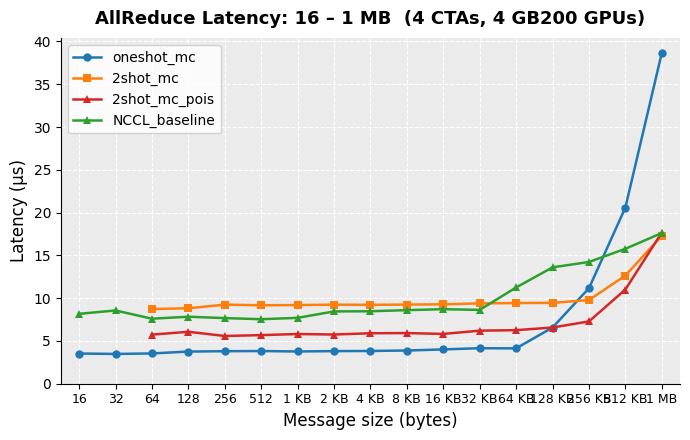
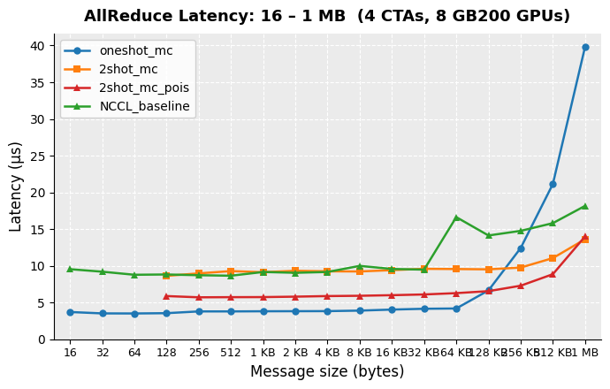

# Custom AllReduce Kernels using the NCCL Device API

This directory contains example custom CUDA kernels that implement
AllReduce collective operations on top of the **NCCL device API**
(`nccl_device.h`), without going through the standard NCCL host API.  They
are intended to show how application and library developers can build
high-performance AllReduce algorithms directly on the device API.

Three kernels use NVLink multicast (MC) hardware available on
Hopper/Blackwell GPUs (sm ≥ 9.0).  They use **multicast virtual addresses**
obtained via `ncclGetLsaMultimemPointer`, which let a single PTX instruction
address all ranks' symmetric buffers simultaneously.  This eliminates unicast
round-trips and enables hardware-reduced AllReduce in one or two NVLink
passes.

Two kernels (`oneshot_lsa_push` and `oneshot_lsa_push_ll`) need no
multicast and no NVLink.  They use plain LSA (load/store accessible) unicast
pointers, so they also run on GPUs that reach each other only through PCIe
peer-to-peer, such as two T4s behind a PCIe host bridge.

## Motivation

NCCL exposes a device-side API that gives custom CUDA kernels direct access to
the same NVLink primitives NCCL uses internally:

- **`ncclDevComm`** — device-side communicator passed by value to a kernel;
  carries team membership, barrier slots, window metadata, and the multicast
  base pointer when `lsaMultimem=true`.
- **`ncclGetLsaMultimemPointer`** — resolves the multicast VA for a symmetric
  window, enabling `multimem.*` PTX instructions that address all ranks at once.
- **`ncclLsaBarrierSession`** — lightweight inter-rank barrier that
  synchronises only the GPUs in the LSA team, without CPU involvement.

Key PTX instructions used by these kernels:

| Instruction                             | Effect                                                                                                                 |
|-----------------------------------------|------------------------------------------------------------------------------------------------------------------------|
| `multimem.ld_reduce.global.add.v4.f32` | Atomically loads from all ranks' multicast VA and returns the hardware sum — one instruction performs the full reduction |
| `multimem.st.global.v4.f32`            | Stores to all ranks' multicast VA simultaneously — one instruction broadcasts to every peer's buffer                   |

---

## Kernels

### 1. `oneshot_mc_allreduce_kernel` — Single-pass Multicast AllReduce

**File:** `oneshot_mc_allreduce_kernel.cuh`

Each GPU independently issues `multimem.ld_reduce.add.v4.f32` across the full
message.  The hardware reads ALL ranks' `sendBuff[i]` simultaneously through
the multicast VA and returns the sum directly — no inter-rank software
communication is needed at all.

**Algorithm:**
1. **Reduce** — A grid-stride loop issues one `multimem.ld_reduce` per
   `float4` element, writing the result directly to the local `recvBuff`.
   Every rank executes the same loop independently, so no barriers or
   sentinels are required.

**Trade-off:** The simplest possible kernel.  Latency is dominated by the NVLink
  multicast read latency (~3.5 µs), flat across message sizes (small-message
regime) and independent of rank count.

---

### 2. `twoshot_mc_simple_allreduce_kernel` — Barrier-based Twoshot AllReduce

**File:** `twoshot_mc_simple_allreduce_kernel.cuh`

A two-shot AllReduce (ReduceScatter + AllGather) where both shots are fused
into a single element-wise loop, using multicast hardware for both.

**Algorithm:**
1. **ReduceScatter (Shot 1)** — Each rank is assigned a chunk of
   `nlines / nRanks` elements.  Within its chunk, each thread issues
   `multimem.ld_reduce` to atomically read all ranks' `sendBuff[i]` and obtain
   the reduced sum.
2. **AllGather (Shot 2)** — The reduced value is immediately broadcast to all
   ranks' `recvBuff[i]` via `multimem.st` — a single NVLink multicast store.
   Shots 1 and 2 are fused per element: no intermediate buffer is needed.
3. **Exit barrier** — `ncclLsaBarrierSession` (release/acquire) ensures all
   AllGather stores are globally visible before any rank reads `recvBuff`.

**Trade-off:** Requires an exit barrier, but the two-shot structure means each
rank only reduces `1/nRanks` of the data,
allowing bandwidth to scale with rank count.  `nlines` must be divisible by
`nRanks`.

---

### 3. `twoshot_mc_poison_allreduce_kernel` — Barrier-free Twoshot AllReduce

**File:** `twoshot_mc_poison_allreduce_kernel.cuh`

Eliminates the exit barrier of `twoshot_mc_simple` by using a Lamport sentinel
embedded in each data slot to detect arrival — the same technique used by
`lsa_poison_alltoall_kernel`.

**Algorithm:**
1. **Optional entry barrier** — On the first two iterations per buffer,
   ensures all ranks have finished re-poisoning this buffer before new data
   is written.  Skipped in steady state (`skip_barrier=true`).
2. **ReduceScatter + AllGather** — Identical to `twoshot_mc_simple`: each
   thread issues `multimem.ld_reduce` then `multimem.st` for its assigned
   element.  After `multimem.st`, the `.w` field of `recvBuf[i]` on every
   rank transitions from `LSA_POISON` (`0xFFFAFFFA`) to the real data value.
   Because NVLink issues `float4` stores as single 128-bit transactions,
   observing `.w != POISON` guarantees the full element has arrived in L2.
3. **Poll** — Each rank spins on its local `recvBuf` using
   `cuda::atomic_ref<uint32_t, cuda::thread_scope_system>` with
   `memory_order_relaxed` (`ld.relaxed.sys`), which bypasses the non-coherent
   L1 cache and reads directly from L2 — sufficient to observe remote NVLink
   writes.
4. **Inline re-poison (triple buffering)** — After polling, the kernel
   re-poisons the `.w` field of each slot in `clearBuf` (the buffer used two
   iterations ago), preparing it for reuse without a separate `cudaMemset`.
   Three symmetric buffers rotate each iteration:
   - `recvBuf  = bufs[iter % 3]`       — receives result this iteration
   - `clearBuf = bufs[(iter + 2) % 3]` — re-poisoned inline, ready 1 iter later

**Trade-off:** No exit barrier in steady state.  Latency floor is ~5.6 µs
(NVLink round-trip + poll), flat across rank counts.  Requires three symmetric
buffer allocations and host-side rotation logic.

### 4. `oneshot_lsa_push_allreduce_kernel`: One-shot Push AllReduce (PCIe P2P)

**File:** `oneshot_lsa_push_allreduce_kernel.cuh`

Each rank writes its whole input into a scratch window on every peer, then
reduces locally.  On PCIe, a remote store is a posted write: the sender does
not wait for it.  A remote load costs a full PCIe round trip.  So the kernel
pushes data to the peers and never reads remote memory.

**Algorithm** (each CTA owns one contiguous chunk of the message):
1. **Push**: plain `float4` stores through `ncclGetLsaPointer` copy
   `sendBuff[chunk]` into `scratch[slot][myRank][chunk]` on every peer.
2. **Barrier**: `ncclLsaBarrierSession` (one barrier per CTA) with
   `memory_order_acq_rel`.  Arrive releases this CTA's remote stores.  Wait
   acquires the peers' stores into this rank's scratch.
3. **Reduce**: `recvBuff[i]` is the sum, in rank order, of this rank's
   `sendBuff[i]` and the peers' copies in local scratch.  Every rank sums in
   the same order, so all ranks get bit-identical results.

The scratch window has two slots.  The host alternates the slot on every
call.  One barrier per call is enough: a rank can only start call k+2 after
its call k+1 barrier, and that barrier needs every peer to have started call
k+1, which runs after the peer finished reading the slot in call k.

**Trade-off:** One communication step, and each rank sends exactly its own
message to each peer.  For 2 ranks this is the same number of bytes as a ring
(reduce-scatter + all-gather), in one step instead of two.  The barrier costs
one PCIe round trip (the release fence) plus one one-way flag write.  Scratch
memory is 2 × nRanks × message size.

---

### 5. `oneshot_lsa_push_ll_allreduce_kernel`: One-shot Push AllReduce with LL Flags

**File:** `oneshot_lsa_push_ll_allreduce_kernel.cuh`

Same data path as `oneshot_lsa_push`, but completion is detected per element
instead of with a barrier.  It uses the device API's `ncclLLA2ASession`:
`send()` writes every 8 bytes of payload as one 16-byte store
`{data0, epoch, data1, epoch}` (`st.relaxed.sys`) into the peer's LL buffer,
and `recv()` polls the local buffer until both epoch words match.

**Algorithm** (each CTA owns one contiguous chunk of the message):
1. **Push**: `send(peer, idx, sendBuff[i])` for every peer.
2. **Reduce**: `recvBuff[i]` is the rank-ordered sum of `sendBuff[i]` and
   `recv(idx)` for each peer.
3. **End epoch**: `endEpoch()` flips the LL slot parity for the next call.

Each 8-byte half carries its own flag, so the protocol relies only on 8-byte
store atomicity.  That also holds over PCIe; NCCL's LL protocol makes the
same assumption.  A 16-byte or 128-byte flag granularity (as in LL128 or a
poison sentinel in `.w`) is not safe over PCIe.

The session keeps its epoch in device memory, so there is no host-side slot
argument and the kernel can be replayed from a CUDA graph.

**Trade-off:** No fence, no barrier and no round trip: each thread continues
as soon as its own elements have arrived.  The cost is 2× the bytes on the
wire, so it wins for small messages and loses once the transfer is
bandwidth-bound.

### Memory ordering over PCIe (both push kernels)

PCIe peer memory is not coherent with the reader's caches, and a reader that
polls a flag with relaxed ordering can see the flag before the data it
guards.  vLLM hit exactly this on PCIe: its custom all-reduce, with a relaxed
start barrier, read stale data on every call
([vllm#61848](https://github.com/vllm-project/vllm/pull/61848)).  The push
kernels avoid it as follows.

- **`oneshot_lsa_push`**: every hand-off between ranks goes through the LSA
  barrier with `memory_order_acq_rel` at system scope.  The arrive is a
  release: after the CTA synchronises, a system-scope fence orders all of the
  CTA's remote data stores before its flag store.  The wait is an acquire, so
  the local scratch reads in the reduce step see the peers' data.  No data is
  read through a relaxed flag.
- **`oneshot_lsa_push_ll`**: there is no fence, so no ordering between
  separate stores is assumed.  Each 8-byte word holds 4 bytes of data and its
  own 4-byte epoch flag, and an aligned 8-byte store reaches the peer as one
  unit (the same assumption as NCCL's LL protocol).  A reader that sees the
  current epoch in a word has that word's data.  Data left from an earlier
  call carries an older epoch and is rejected.
- **Slot reuse** (write-after-read): both kernels alternate between two
  slots.  A rank writes a slot again only in call k+2.  It can only start
  call k+2 after it has received every peer's call k+1 data, and each peer
  sends that only after its call k (which read the slot) has finished, in
  stream order.

compute-sanitizer `memcheck`, `racecheck` and `synccheck` report no
errors for the push kernels (2 × A10, 1 KB to 1 MB, with and without CUDA
graphs).  This covers memory errors and shared-memory races only, not
cross-GPU ordering, which the chained correctness test checks.

### Element types

Both push kernels are templated on the element type: `float`, `__half`
and `__nv_bfloat16` (`lsa_push_reduce.cuh`).  Data moves as 16-byte lines
for every type, so only the local add changes.  Sums are in rank order on
every rank, so all ranks get bit-identical results in every type.  The driver
tests half and bf16 with exact expected values, and `--dtype` selects the
type for the sweep (the MC kernels are float only and are skipped).

---

## Performance

Numbers below are for 4 CTAs, measuring per-iteration latency in steady state
(CUDA graph, `skip_barrier=true` for the poison kernel).

### 4 × GB200

| msg    | oneshot_mc (µs) | 2shot_mc (µs) | 2shot_mc_pois (µs) | NCCL (µs) |
|--------|-----------------|---------------|--------------------|-----------|
| 16 B   | 3.53            | N/A           | N/A                | 8.17      |
| 32 B   | 3.48            | N/A           | N/A                | 8.56      |
| 64 B   | 3.54            | 8.73          | 5.74               | 7.60      |
| 128 B  | 3.76            | 8.82          | 6.07               | 7.83      |
| 256 B  | 3.80            | 9.24          | 5.58               | 7.67      |
| 512 B  | 3.82            | 9.17          | 5.68               | 7.54      |
| 1 KB   | 3.77            | 9.19          | 5.81               | 7.70      |
| 2 KB   | 3.81            | 9.24          | 5.75               | 8.45      |
| 4 KB   | 3.83            | 9.22          | 5.90               | 8.47      |
| 8 KB   | 3.88            | 9.25          | 5.92               | 8.60      |
| 16 KB  | 4.01            | 9.28          | 5.82               | 8.71      |
| 32 KB  | 4.15            | 9.39          | 6.20               | 8.63      |
| 64 KB  | 4.13            | 9.43          | 6.26               | 11.25     |
| 128 KB | 6.57            | 9.45          | 6.57               | 13.60     |
| 256 KB | 11.16           | 9.78          | 7.28               | 14.23     |
| 512 KB | 20.59           | 12.64         | 11.01              | 15.77     |
| 1 MB   | 38.66           | 17.29         | 17.67              | 17.61     |



### 8 × GB200

| msg    | oneshot_mc (µs) | 2shot_mc (µs) | 2shot_mc_pois (µs) | NCCL (µs) |
|--------|-----------------|---------------|--------------------|-----------|
| 16 B   | 3.71            | N/A           | N/A                | 9.54      |
| 32 B   | 3.52            | N/A           | N/A                | 9.20      |
| 64 B   | 3.51            | N/A           | N/A                | 8.78      |
| 128 B  | 3.55            | 8.63          | 5.88               | 8.82      |
| 256 B  | 3.79            | 8.97          | 5.71               | 8.72      |
| 512 B  | 3.79            | 9.28          | 5.73               | 8.65      |
| 1 KB   | 3.81            | 9.13          | 5.74               | 9.16      |
| 2 KB   | 3.82            | 9.32          | 5.80               | 9.05      |
| 4 KB   | 3.83            | 9.25          | 5.88               | 9.16      |
| 8 KB   | 3.90            | 9.23          | 5.92               | 9.99      |
| 16 KB  | 4.04            | 9.41          | 6.00               | 9.57      |
| 32 KB  | 4.15            | 9.59          | 6.10               | 9.48      |
| 64 KB  | 4.19            | 9.56          | 6.28               | 16.63     |
| 128 KB | 6.65            | 9.52          | 6.55               | 14.13     |
| 256 KB | 12.42           | 9.76          | 7.29               | 14.76     |
| 512 KB | 21.14           | 11.05         | 8.86               | 15.81     |
| 1 MB   | 39.82           | 13.62         | 14.00              | 18.16     |



**Key observations:**
- `oneshot_mc` achieves ~3.5 µs flat — roughly 2× lower than NCCL — because
  one `multimem.ld_reduce` instruction replaces the entire reduce-scatter phase.
- `twoshot_mc_pois` (~5.7 µs) is faster than `twoshot_mc_simple` (~9 µs) by
  eliminating the exit barrier; its latency is stable across 4 and 8 GPUs.
- All three MC kernels show nearly identical latency at 4 and 8 GPUs,
  confirming the multicast approach scales with rank count.
- NCCL baseline rises from ~8 µs (4 GPUs) to ~9 µs (8 GPUs) in this range.

### 2 × T4 over PCIe (push kernels)

Kaggle VM with two Tesla T4s (sm_75) behind a PCIe host bridge (PHB).  CUDA
P2P works in both directions (`nvidia-smi topo -p2p r` and `-p2p w` report
`OK`), driver 580.178.04, CUDA 12.8, NCCL built from this tree.  The
communicator reports Device API support with one LSA team; there is no
multicast, so the MC kernels are skipped.

Same driver and method as above: CUDA graph, back-to-back iterations, the
maximum over ranks.  Each cell is the median over 20 runs of the driver
(4 Kaggle VM sessions × 5 runs), each run taking the best CTA count from `-c 1 -C 64`.
Push kernels use 512 threads per CTA.  NCCL is `ncclAllReduce` in the same
process, with `NCCL_P2P_LEVEL=PHB` so that it uses its P2P transport
(`P2P/CUMEM`, Ring algorithm, LL protocol at small sizes).  With default settings NCCL uses SHM on
this topology and is slower (last column).

| Size | NCCL, P2P (us) | push_lsa (us) | push_lsa_ll (us) | Best vs NCCL | NCCL, default (us) |
|---:|---:|---:|---:|---:|---:|
| 1 KB | 8.9 | 6.2 | **3.5** | 2.53x | 10.6 |
| 2 KB | 9.0 | 6.1 | **3.8** | 2.39x | 11.0 |
| 4 KB | 9.4 | 6.4 | **4.3** | 2.17x | 12.1 |
| 8 KB | 11.2 | 7.0 | **5.4** | 2.07x | 14.7 |
| 16 KB | 15.9 | 8.8 | **7.8** | 2.03x | 19.1 |
| 32 KB | 22.4 | **12.3** | 15.4 | 1.82x | 26.5 |
| 64 KB | 37.5 | **19.1** | 34.8 | 1.97x | 42.3 |
| 128 KB | 60.9 | **37.7** | 71.4 | 1.61x | 66.5 |
| 256 KB | 89.7 | **73.8** | 146.2 | 1.21x | 102.3 |
| 512 KB | 149.7 | **147.0** | 299.2 | 1.02x | 159.9 |
| 1 MB | **268.0** | 291.7 | 613.8 | 0.92x | 283.3 |

"Best vs NCCL" is NCCL (P2P) divided by the faster push kernel.

**Key observations:**
- Below ~16 KB, `oneshot_lsa_push_ll` is fastest: about 3.5 µs at 1 KB.  An
  empty kernel timed the same way takes ~1.1 µs, so the rest is about one
  one-way PCIe write plus polling.
- From 32 KB to 256 KB, `oneshot_lsa_push` is fastest, 1.2× to 2× faster
  than NCCL.  The PCIe link moves about 4 GB/s per direction on this VM, and
  from 64 KB the push kernel is within ~3 µs of that bandwidth floor.  NCCL's
  ring sends the same number of bytes in two dependent steps.
- At 512 KB the push kernel and NCCL are even.  At 1 MB NCCL is ~8% faster.
  Use NCCL for large messages.
- Best CTA counts (`oneshot_lsa_push`): 1 up to 4 KB, 4 for 8-16 KB, 8 for
  32-64 KB, 16 from 128 KB.  `oneshot_lsa_push_ll` is best with 1 CTA.

---

## Building

NCCL must be built first:

```bash
make src.build
```

Then build the benchmark (MPI required):

```bash
make -C contrib/custom_algos/allreduce MPI=1
```

Optional variables:

| Variable    | Default               | Description               |
|-------------|-----------------------|---------------------------|
| `MPI_HOME`  | detected from `mpicc` | Path to MPI installation  |
| `CUDA_HOME` | `/usr/local/cuda`     | Path to CUDA installation |
| `DEBUG=1`   | off                   | Debug build (`-O0 -G -g`) |

The binary is written to `build/test/custom_algos/allreduce/allreduce`.

---

## Running

```bash
mpirun -np <N> build/test/custom_algos/allreduce/allreduce [options]
```

| Option            | Default | Description                              |
|-------------------|---------|------------------------------------------|
| `-c, --min-cta N` | 1       | Smallest CTA count to sweep (power of 2) |
| `-C, --max-cta N` | 1       | Largest CTA count to sweep (power of 2)  |
| `-m, --min-msg B` | 16      | Smallest message size in bytes           |
| `-M, --max-msg B` | 128 MB  | Largest message size in bytes            |
| `--no-graph`      | off     | Disable CUDA graph capture               |
| `-d, --dtype T`   | float   | `float`, `half` or `bf16` for the push kernels and the NCCL baseline |

The driver runs correctness tests for all kernels the hardware supports
first, then a latency sweep printing one row per message size per CTA count.
The push kernels are measured up to 1 MB (`PUSH_MAX_BYTES`).

---

## Prerequisites

- NCCL built from source (this repo)
- CUDA ≥ 12.2
- MPI (OpenMPI or MVAPICH)
- MC kernels: GPU compute capability ≥ 9.0 (Hopper / Blackwell), required
  for the `multimem.ld_reduce` and `multimem.st` PTX instructions, and an
  NVLink island with ≥ 2 GPUs and multicast support enabled
- Push kernels: a communicator that reports `deviceApiSupport` with a single
  LSA team (`nLsaTeams == 1`).  On PCIe this needs working CUDA P2P between
  all GPUs.  They are written for any team size but have been measured with
  2 GPUs only.
