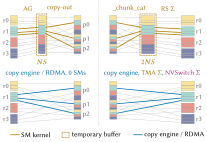
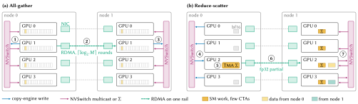
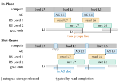
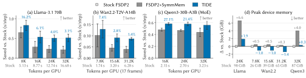
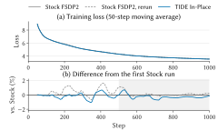
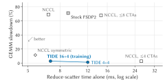
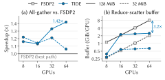

<div align="center">
  
  <h3>Layout-aware collectives on copy engines, RDMA and NVSwitch for fully sharded training</h3>
  <a href="https://arxiv.org/abs/2610.38228"><b>Paper</b></a>
  &nbsp;·&nbsp;
  <a href="#results"><b>Results</b></a>
  &nbsp;·&nbsp;
  <a href="#quick-start"><b>Quick Start</b></a>
  &nbsp;·&nbsp;
  <a href="#documentation"><b>Docs</b></a>
  &nbsp;·&nbsp;
  <a href="#citation"><b>Citation</b></a>
  <br><br>
  <a href="https://arxiv.org/abs/2610.38228"></a>
  <a href="https://kling.ai/"></a>
  <a href="LICENSE"></a>
  <a href="https://github.com/NVIDIA/nccl"></a>
  <a href="https://docs.pytorch.org/docs/stable/distributed.fsdp.fully_shard.html"></a>
  <br>
</div>

**TIDE** (**T**opology-aware **I**n-place **D**irect **E**xchange) is the all-gather and reduce-scatter of fully
sharded training (FSDP2, ZeRO-3), rebuilt so that the bytes go where the model needs them. It is built on NCCL's public
host and device APIs (NCCL >= 2.31.2).

- **Zero-copy** — the all-gather lands every piece directly in its parameter's storage and reads the sharded
  parameters in place; the reduce-scatter reads the gradients where autograd left them. FSDP2's copy-in, copy-out and
  `_chunk_cat` packing are gone.
- **Off the SMs** — copy engines, RDMA and the NVSwitch move the bytes: the all-gather uses no SMs, the reduce-scatter
  a few short-lived CTAs for its fp32 sum.
- **Drop-in for FSDP2** — one call after `fully_shard`, for regular, HSDP and expert-parallel groups; groups it cannot
  serve stay on the stock path.

On 64 GPUs, TIDE cuts step time by up to **27.1%** against stock FSDP2 and **6.0%** against FSDP2 with symmetric
memory, across Llama-3.1 70B, Wan2.2 and Qwen3-30B-A3B ([results](#results)).

## Why TIDE

A sharded training step pays for more than the collectives:

- before each all-gather, FSDP2 copies the shards into a staging buffer, and after it copies the
  rank-major result out into each parameter's storage;
- before each reduce-scatter, it packs the gradients into an fp32 buffer (`_chunk_cat`);
- NCCL's kernels keep 16-32 CTAs resident, pushing a co-running GEMM that fills the GPU into a second
  wave.

FSDP2's symmetric-memory option moves the all-gather onto copy engines; the copies, the packing and the
reduce-scatter's CTAs remain.

<div align="center">
  
</div>

*FSDP2's contract boundary for one parameter group (3 parameters, N = 4 ranks, shard size S; tile color marks the
owning rank, and colored lines trace rank 1's pieces). Stock FSDP2 converts layouts with SM kernels and temporary
buffers; TIDE writes each piece once, at its final address. (Figure 1 of the report.)*

## How it works

<div align="center">
  
</div>

*TIDE's collective paths (two nodes; four of eight GPUs shown). (a) All-gather: local multicast ①, rail RDMA ②,
destination multicast ③. (b) Reduce-scatter: copy-engine staging ④, TMA fp32 sums ⑤, rail RDMA ⑥, NVSwitch
reduction ⑦. (Figure 2 of the report.)*

- **All-gather**: every `(parameter, rank)` piece lands at its final offset in the parameter's storage, and
  the sharded parameters are read in place: no copy-in, no copy-out, no SM work. Inside a node one
  copy-engine write reaches all eight GPUs through NVSwitch multicast (①); across nodes each byte crosses
  one NIC (②), in rail-aligned, paced rounds (recursive doubling), and a copy engine multicasts it from the
  receive stage into every local GPU (③).
- **Reduce-scatter**: copy engines push each GPU's bf16 pieces to their owner straight from the gradients
  (④), which sums them in fp32 with a few CTAs, 4 or 8 on one node (⑤); fp32 partials cross the rail in
  paced rounds (⑥), and a landing kernel of 1-4 CTAs reads them through the NVSwitch, which adds them
  (`multimem.ld_reduce`, ⑦). The output is FSDP2's packed fp32 shard, bitwise reproducible run to run and
  independent of the CTA count, round width and chunking.
- **Pipelining**: a multi-node reduce-scatter runs in a read phase (the pushes and sums, waiting only for
  the gradients) and a network phase queued behind the previous call's, so one call reads while the
  previous one is on the NIC; the network phase can run in device kernels on NCCL's GIN
  (`TIDE_RS_NET=device`, experimental).
- **FSDP2 adapter**: `tide.fsdp.install(model, comm)` after `fully_shard`, in one of two modes (below);
  with `subgroups=True` it also serves the expert groups of expert parallelism; groups it cannot serve stay
  on the stock path.

### How it compares

| | FSDP2 default | FSDP2 + symmetric memory | NCCL symmetric kernels | TIDE |
|---|---|---|---|---|
| all-gather lands in parameter storage | no (copy-out kernel) | no (copy-out kernel) | no | yes |
| all-gather moved by | SM kernel | copy engines | SM kernel | copy engines, NVSwitch multicast, RDMA |
| reduce-scatter input | packed fp32 (`_chunk_cat`) | packed fp32 | packed fp32 in a symmetric window | gradients in place (throughput mode: one bf16 copy) |
| reduce-scatter SM use | 16-32 CTAs | CTAs | CTAs for the whole collective | a few CTAs + NVSwitch |

The details and the reasons are in [docs/overview.md](docs/overview.md).

## Two modes

The FSDP2 adapter runs in one of two modes, which differ in where a layer's gradients wait while the
reduce-scatter reads them.

<div align="center">
  
</div>

*Backward scheduling in the two modes. In-Place (efficiency mode) lets the next all-gather run during
reduce-scatter but briefly keeps two gradient groups live; Slot-Reuse (throughput mode) copies gradients into a
vacated all-gather slot and gates the slot's reuse on read completion. (Figure 7 of the report.)*

| | Efficiency mode (default; *In-Place* in the report) | Throughput mode (`TIDE_FSDP_COPYIN=1`; *Slot-Reuse* in the report) |
|---|---|---|
| reduce-scatter input | the gradients, in place | a copy of them in the all-gather slot the layer has just left |
| gradients freed | at the next layer's post-backward, so one layer of them outlives its backward | right after the copy |
| next backward all-gather | at once, ahead of the reduce-scatter's network phase | once the reduce-scatter has read the slot |
| memory held | the two all-gather slots and one layer of gradients | the two all-gather slots, which also hold the gradients |
| cost | one layer of gradients | one copy per layer on the compute stream; the all-gather waits for the reads |

The mode is chosen at install and must be the same on every rank. Efficiency mode plans the reduce-scatter to read
early into two outbox banks, so one layer's reads can overlap the previous layer's network phase; throughput mode,
with nothing to free early, gives each bank two NIC rounds and lets the later reads follow the NIC. Single-node
calls and lanes with one rank per node read in one phase.

### Which to use

TIDE pays off where FSDP's glue is a visible share of the step: many parameter groups, large groups relative
to the compute per step (fewer tokens per GPU), multi-node runs on RoCE or InfiniBand rails, and MoE layers,
whose small grouped GEMMs lose the most to resident communication CTAs. Efficiency mode keeps the
communication off the critical path. Where the collectives already hide behind long compute, the gain shrinks
to the freed SMs, and throughput mode trades one copy per layer for a layer of gradients, for example to fit a
larger batch.

## Results

### Training (64 GPUs)

From the [technical report](https://arxiv.org/abs/2610.38228) (Section 7): 8 nodes of 8 GPUs, one RDMA rail per GPU;
stock FSDP2, FSDP2 with PyTorch symmetric memory (FSDP2 + SymmMem) and TIDE share the model, precision, optimizer,
activation checkpointing and inputs; median step times; efficiency mode on Llama and Qwen3, throughput mode on Wan2.2.

<div align="center">
  
</div>

*TIDE is fastest at every point and uses less memory than FSDP2 + SymmMem (64 GPUs; Llama and Qwen3: In-Place; Wan:
Slot-Reuse). (a–c) Time saved versus stock; labels are the relative saving, stock's step time is under each group, and
error bars summarize run-to-run variation. (d) Peak memory versus stock (repeats within 0.1 GiB). (Figure 8 of the
report.)*

| Model | Tokens per GPU | Step time vs stock FSDP2 | vs FSDP2 + SymmMem |
|---|---|---|---|
| Llama-3.1 70B (dense) | 8K – 32K | −16.2% … −3.1% | saves 1.9–2.4× as much time (16K – 32K) |
| Wan2.2-T2V-A14B, high-noise expert (diffusion, 17 frames) | 7.8K – 31.2K | −7.4% … −1.4% | saves about 2× as much time (15.6K, 31.2K) |
| Qwen3-30B-A3B (MoE) | 16K – 32K | **−27.1%** … −17.3% | **−6.0%** … −4.3% |

- **Fastest at every measured point**, and both collectives contribute: replacing one at a time returns about half
  of the combined saving each.
- **Memory**: a lower peak than FSDP2 + SymmMem on all three models, by up to 4.7 GiB; on Wan2.2, throughput mode
  peaks 1.0–1.4 GiB below stock FSDP2.
- **SMs**: the all-gather uses none, so concurrent compute slows by at most 0.5%; the reduce-scatter uses
  12.5–14.5× less SM time than either baseline.

### Accuracy

The all-gather is bitwise identical to stock FSDP2's. The reduce-scatter sums in fp32 in a fixed order, so it is
bitwise reproducible run to run and differs from stock only by the fp32 summation order
([docs/numerics.md](docs/numerics.md)).

Training Qwen3-30B-A3B from scratch on C4 (64 GPUs, 4 x 4096 tokens per GPU, 1000 steps), TIDE's loss stays inside
stock FSDP2's own run-to-run variation: over steps 500–1000 its 50-step moving average is within **0.73%** of a
stock run, while a second, identically configured stock run differs from the first by up to **1.12%**.

<div align="center">
  
</div>

*Qwen3-30B-A3B trained from scratch on public C4 (64 GPUs, 1,000 steps). (a) 50-step moving-average loss.
(b) Difference from the first stock run; the maxima above are over the shaded steps 500–1,000. (Figure 12 of the
report.)*

### Collectives (1–8 nodes)

From the report's Section 7 and appendix (8 GPUs per node, NVLink through NVSwitch, one 400G single-port RoCE NIC
per GPU, stock NCCL 2.31.2; full tables and commands in [docs/benchmarks.md](docs/benchmarks.md)):

- **Compute slowdown under overlap (8 nodes).** Concurrent 32 MiB reduce-scatters at a fixed SM clock slow a one-wave
  GEMM by **2.9%** with TIDE's training configuration (16 sum + 4 landing CTAs) and **1.3%** with 4 + 4 CTAs, against
  **71.0%** for stock FSDP2 and **9.7%** for FSDP2 + SymmMem; a memory-bound kernel by 1.6% and 0.6%, against 13.3%
  and 13.6% (medians of three launches). Only TIDE's training configuration finishes the reduce-scatter faster than
  stock FSDP2 while slowing the one-wave GEMM by less than 4%.
- **All-gather.** Including FSDP2's copy-out, TIDE-AG is **1.06–1.42x** faster at the median than FSDP2's fastest
  all-gather across 1–8 nodes and 32–128 MiB shards, and uses no SMs.
- **Reduce-scatter.** TIDE-RS keeps its buffer flat while FSDP2's grows with the GPU count: at 8 nodes and 128 MiB
  outputs it takes **2.51 GiB instead of 8.12 GiB** per GPU and is **1.11x faster at the minimum and 1.36x at the
  median** than FSDP2's `_chunk_cat` + NCCL path.

<div align="center">
   
</div>

*Left: reduce-scatter time versus one-wave GEMM slowdown; hollow markers: pre-packed fp32 input (Figure 11 of the
report). Right: TIDE-AG stays faster from 8 to 64 GPUs and its reduce-scatter buffer stays flat; (a) median speedup
over FSDP2's fastest all-gather, (b) buffer per GPU (Figure 10 of the report).*

## Quick Start

### 1. Requirements

- NVIDIA GPUs of compute capability 9.0 or newer with about 207 KB of shared memory per block (TMA), up to 8
  per NVLink domain, behind an NVSwitch with multicast (NVLS), which multi-node reduce-scatters require.
- NCCL 2.31.2 or newer for the whole process (checked at startup), PyTorch 2.13 or newer, Python 3.10 or newer.
- On several nodes, one RDMA NIC per GPU (RoCE or InfiniBand) that NCCL can drive; each transfer stays on its
  rail (GPU i to GPU i of the other nodes).
- To build: the CUDA toolkit PyTorch was built with, and a C++20 compiler (PyTorch 2.13 builds its extensions as C++20).

### 2. Install

```bash
git clone https://github.com/NVIDIA/nccl.git && cd nccl
make -j src.build                                      # NCCL itself -> build/
cd contrib/tide
pip install -e . --no-build-isolation --no-deps        # or scripts/build.sh (adds the test fault hooks)
```

The extension builds against `../../build`, or against the NCCL build in `NCCL_HOME` if set. Every process that
uses TIDE runs on that NCCL, torch's process group included: `LD_PRELOAD=<NCCL build>/lib/libnccl.so.2`
(`scripts/run_local.sh` and `scripts/run_multinode.sh` set it). On several nodes, also set
`CUDA_DEVICE_MAX_CONNECTIONS=32` before CUDA starts: with the default eight hardware queues the
reduce-scatter's two phases serialize (the adapter warns).

### 3. Use it from FSDP2

```python
import torch.distributed as dist
from torch.distributed.fsdp import fully_shard
import tide, tide.fsdp

dist.init_process_group("nccl")
model = build_model()                      # your model
for block in model.blocks:
    fully_shard(block)
fully_shard(model)

comm = tide.TideComm()                     # collective: TIDE's own NCCL communicator
tide.fsdp.install(model, comm)             # after fully_shard and any other FSDP patch; efficiency mode,
                                           # or throughput mode with TIDE_FSDP_COPYIN=1 in the environment
# ... train as usual ...
tide.fsdp.uninstall()                      # optional: back to stock FSDP2, arena released
comm.close()
```

With expert parallelism, `tide.fsdp.install(model, comm, subgroups=True)` also takes the expert groups, which FSDP2
shards over a regular subset of the ranks (the same number on every node): each subset gets its own communicator,
arena and ring slots, created inside `install()` ([docs/usage.md](docs/usage.md#expert-groups)).

A standalone reduce-scatter over gradients read in place:

```python
grads = [p.grad for p in params]                              # unsharded bf16 / fp32 gradients, dim-0 sharded
arena = comm.alloc_arena(comm.rs_stage_bytes(grads))          # symmetric window (collective)
h = comm.register_rs(arena, 0, grads)                         # collective, same table on every rank
out, event = h.reduce_scatter(grads, scale=1.0 / comm.nranks) # packed fp32 shard, torch._chunk_cat layout
```

The all-gather API (`register_ag` over a byte table), the knobs and the communicator's memory
are in [docs/usage.md](docs/usage.md).

### Limitations

- The reduce-scatter takes bf16 or fp32 inputs, up to 256 tensors per call, and returns fp32 in FSDP2's packed
  layout.
- At most 8 GPUs per NVLink domain (no NVL16 or NVL72 yet).
- The FSDP2 adapter leaves on the stock path the groups it cannot serve: CPU offload, non-dim-0 sharding, a
  post-forward mesh, process groups TIDE does not cover (any but the communicator's; with `subgroups=True`, any
  that is not a regular subset of the ranks). Parameters with an FSDP2 all-gather extension (an FP8 payload plus
  scales, for instance) are served with a copy-in at every call, and their inputs' dtypes and sizes must not
  change between calls. A group's reduce-scatter falls back for custom reduce-scatter collectives, all-reduce
  hooks and partial reduce outputs; under HSDP the replica all-reduce stays on NCCL.
- With stock NCCL 2.31.2 and 2.32.3, PAT reduce-scatters on communicators with one rank per node return the plain sum for
  AVG; the stock collectives in the same process need `NCCL_ALGO=^PAT`
  ([docs/usage.md](docs/usage.md#known-limitation-nccl-2312-pat-and-avg)).

## Documentation

| | |
|---|---|
| [Technical report](https://arxiv.org/abs/2610.38228) | design, analysis and the end-to-end evaluation |
| [docs/overview.md](docs/overview.md) | what TIDE changes and how it relates to FSDP2's options and NCCL's symmetric kernels |
| [docs/usage.md](docs/usage.md) | how each collective runs, API, knobs, FSDP2 adapter and its modes, tests |
| [docs/numerics.md](docs/numerics.md) | what each collective computes against stock, the tests that check it, and a training run against stock |
| [docs/design_ag.md](docs/design_ag.md) | all-gather design and measurements |
| [docs/design_rs.md](docs/design_rs.md) | reduce-scatter design and measurements |

## Development

<details>
<summary><b>Directory layout</b></summary>

```
csrc/               runtime (Comm: windows, flags, credits, NIC rounds, config), collective/ag, collective/rs, bindings
tide/               Python: TideComm and handles, byte tables, solver (reduce-scatter sizing), fsdp (FSDP2 adapter),
                    testing (test helpers)
test/               torchrun tests (bitwise, invariance, non-finite inputs, fences, concurrency, abort, tuning, FSDP2),
                    test_waves.cpp (host only), test_rs_tma_rail.cu (one GPU)
bench/              all-gather / reduce-scatter / RMA / host-time / interference benchmarks, NIC counters,
                    calibrate.py (solver rates)
scripts/            gate.sh (regression gate), build.sh, run_local.sh, run_multinode.sh
docs/               overview, usage, numerics, design notes, benchmarks; figures/ (charts and their data;
                    figures/paper/: the technical report's figures)
```

</details>

`scripts/gate.sh offline | core1 | coremulti | ep | decouple | 1 | multi | all` is the regression gate:
every leg must exit 0, fault-injection negatives included (`offline` needs no GPU; `core1` + `coremulti`
is the short gate, `ep` adds the expert subgroups; see [CONTRIBUTING.md](CONTRIBUTING.md) and
[docs/usage.md](docs/usage.md#tests)).

## Citation

If you find TIDE helpful, please cite the technical report:

```bibtex
@article{wang2026tide,
  title   = {The Endgame of {FSDP} Communication: Layout-Aware Collectives on Copy Engines, {RDMA},
             and {NVSwitch}},
  author  = {Wang, Zejian and Zhao, Yifan and Ren, Kaihui and Zhou, Xiaoling and Wang, Yubin and Guan, Chenhao and
             Zhang, Lin and Li, Yufeng and Mo, Zhikang and Ma, Zhuoru and Xiong, Yingtong and Guo, Jihu and
             Liao, Yiqiao and Song, Chengru},
  journal = {arXiv preprint arXiv:2610.38228},
  year    = {2026},
  url     = {https://arxiv.org/abs/2610.38228}
}
```

## Contributing

Issues and pull requests go to [NVIDIA/nccl](https://github.com/NVIDIA/nccl) with `contrib/tide` in the title, so
they reach the maintainers below. Every commit carries a DCO sign-off; [CONTRIBUTING.md](CONTRIBUTING.md) lists the
gate stages a change must pass.

## Maintainers

- [@knitcapcat](https://github.com/knitcapcat) — Zejian Wang (<wangzejian@kuaishou.com>)
- [@zhaoyifan222](https://github.com/zhaoyifan222) — Yifan Zhao (<zhaoyifan14@kuaishou.com>)

## License

Apache License 2.0 ([LICENSE](LICENSE)); third-party software is listed in [ThirdPartyNotices.txt](ThirdPartyNotices.txt).
