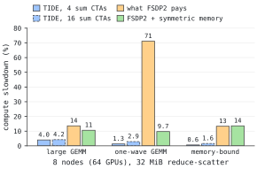
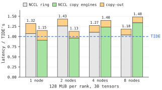
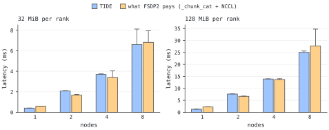

<!-- SPDX-FileCopyrightText: Copyright (c) 2026 Kuaishou Technology. All rights reserved. -->
<!-- SPDX-License-Identifier: Apache-2.0 -->
# TIDE benchmarks

## Setup

- Nodes of 8 GPUs, NVLink through NVSwitch, one 400G single-port RoCE NIC per GPU (rail-aligned).
- Stock NCCL 2.31.2 for TIDE and every NCCL arm (torch's process group included), CUDA 13.2, PyTorch 2.13.
- Per-call latency from CUDA events on rank 0, reported as the minimum over two interleaved 30-iteration
  runs (after warm-up) and, in parentheses, the median.
- "What FSDP2 pays" is the NCCL collective plus the layout work FSDP2 runs around it on the compute
  stream: the fused `split_with_sizes_copy` copy-out after an all-gather, and the `_chunk_cat` fp32
  packing before a reduce-scatter.

## Overlap with compute

Reduce-scatters issued back-to-back on their own stream while a workload runs on the compute stream: 8 nodes,
64 ranks, 32 MiB fp32 output per rank across 16 bf16 gradient tensors, SM clocks locked at 1200 MHz,
`CUDA_DEVICE_MAX_CONNECTIONS=32`. The slowdown counts the workload's iterations that ran entirely inside the
reduce-scatter window: the median over 64 ranks in each run, then the median of three runs (arm order rotated,
each arm a fresh process per run). "Alone" is the reduce-scatter by itself over ten isolated calls per run, the
minimum and, in parentheses, the median, each the median of the three runs.



| reduce-scatter | alone, ms | GEMM 16384 x 8192 x 8192 (~28 waves) | GEMM 256 x 8192 x 8192 (small M, one wave) | elementwise, 256 MiB (memory-bound) |
|---|---|---|---|---|
| TIDE, 4 sum CTAs (the solver's choice at 8 nodes) | 8.82 (12.02) | +4.0% | **+1.3%** | **+0.6%** |
| TIDE, 16 sum CTAs (`TIDE_RS_CTAS=16`, the report's training configuration) | 6.33 (6.96) | +4.2% | **+2.9%** | **+1.6%** |
| what FSDP2 pays (`_chunk_cat` + NCCL) | 8.47 (9.01) | +13.6% | +71.1% | +13.3% |
| FSDP2 with symmetric memory (`_chunk_cat` into the window + NCCL's symmetric kernel, `NCCL_CTA_POLICY=2`) | 7.31 (7.45) | +10.6% | +9.7% | +13.6% |
| NCCL, fp32 input already packed | 6.57 (6.75) | +13.5% | +69.0% | +7.4% |
| NCCL's symmetric kernel, fp32 input already packed in the window | 5.43 (5.57) | +10.3% | +11.4% | +13.4% |
| NCCL, at most 8 CTAs (`NCCL_MAX_CTAS=8`) | 13.01 (14.61) | +7.0% | +67.8% | +7.3% |
| NCCL, at most 4 CTAs | 26.15 (26.35) | +3.8% | +2.7% | +4.1% |

NCCL's default kernel keeps 16 CTAs resident: a one-wave GEMM that fills the GPU cannot fit beside them and runs a
second wave, 68–71% slower whether FSDP2 packs the input or not, and capping NCCL at 8 CTAs barely helps. TIDE's
sum CTAs run only for each round's sums and its landing takes 1–4 CTAs, so the GEMM keeps its single wave: 1.3–2.9%
slower. Capping NCCL at 4 CTAs matches that, at 26 ms per call, about four times NCCL's default and TIDE's 16-CTA
latency. NCCL's symmetric kernel and FSDP2 with symmetric memory leave the one-wave GEMM 10–11% slower and the other
two workloads 10–14%.

The one-wave GEMM's iteration times are bimodal (an iteration that meets resident communication CTAs takes about
twice as long, the others are unaffected), so the median understates frequent collisions. Mean slowdown of the
one-wave GEMM in the third run, median over 64 ranks, in the table's order: TIDE 6.1% (4 sum CTAs) and 8.8% (16);
what FSDP2 pays 97.6%; FSDP2 with symmetric memory 49.5%; NCCL 44.9%, symmetric kernel 21.8%, at most 8 CTAs 49.2%,
at most 4 CTAs 3.5%. The memory-bound workload is the noisiest: TIDE with 16 sum CTAs measured +0.2%, +7.9% and +1.6%
in the three runs. At ten calls per run the reduce-scatter alone carries the network's tail (TIDE with 4 sum CTAs:
medians of 9.3–14.4 ms, minimum 8.5 ms); the latency comparisons are the 1–8 node tables below.

## End-to-end collective latency and memory

### All-gather against FSDP2's options, 1–8 nodes

Groups of 30 tensors (1 / 2 / 4 / 8 nodes, two interleaved runs per configuration; minimum ms, median in
parentheses). NCCL's copy-engine all-gather is what FSDP2 runs with `set_symm_mem_for_comm` and a
zero-CTA process group (`NCCL_CTA_POLICY=2`); "+ copy-out" adds FSDP2's fused `split_with_sizes_copy`
from the rank-major output into per-parameter storage. TIDE with 30 tensors takes the same time as with
1 tensor (within 1%) and lands directly in parameter storage. All arms verified byte-exact.



128 MiB per rank (30 tensors):

| nodes | TIDE | NCCL ring | NCCL copy engines | ring + copy-out | copy engines + copy-out | TIDE faster than best FSDP2 path (medians) |
|---|---|---|---|---|---|---|
| 1 | **1.40 (1.41)** | 1.50 (1.52) | 1.27 (1.28) | 1.85 (1.87) | 1.61 (1.63) | **1.16x** |
| 2 | **4.19 (4.20)** | 5.29 (6.09) | 4.04 (4.13) | 5.99 (6.84) | 4.73 (4.76) | **1.13x** |
| 4 | **9.76 (9.80)** | 10.78 (13.48) | 12.03 (13.27) | 12.42 (13.01) | 13.64 (14.06) | **1.33x** |
| 8 | **20.89 (21.41)** | 21.73 (23.41) | 28.01 (30.90) | 24.74 (30.35) | 31.00 (32.75) | **1.42x** |

32 MiB per rank (30 tensors):

| nodes | TIDE | NCCL ring | NCCL copy engines | ring + copy-out | copy engines + copy-out | TIDE faster than best FSDP2 path (medians) |
|---|---|---|---|---|---|---|
| 1 | **0.38 (0.38)** | 0.40 (0.41) | 0.35 (0.36) | 0.50 (0.51) | 0.45 (0.46) | **1.22x** |
| 2 | **1.11 (1.12)** | 1.35 (1.59) | 1.08 (1.10) | 1.53 (1.58) | 1.26 (1.28) | **1.14x** |
| 4 | **2.57 (2.60)** | 2.71 (2.79) | 3.14 (3.22) | 3.11 (3.14) | 3.56 (3.62) | **1.21x** |
| 8 | **5.52 (5.86)** | 5.46 (5.78) | 7.25 (7.42) | 6.15 (6.21) | 7.96 (8.19) | **1.06x** |

64 MiB per rank (30 tensors):

| nodes | TIDE | NCCL ring | NCCL copy engines | ring + copy-out | copy engines + copy-out | TIDE faster than best FSDP2 path (medians) |
|---|---|---|---|---|---|---|
| 1 | **0.72 (0.72)** | 0.77 (0.79) | 0.65 (0.66) | 0.95 (0.97) | 0.84 (0.85) | **1.18x** |
| 2 | **2.14 (2.15)** | 2.67 (2.69) | 2.06 (2.08) | 3.06 (3.10) | 2.47 (2.48) | **1.15x** |
| 4 | **4.97 (5.00)** | 5.39 (5.48) | 6.10 (6.49) | 6.10 (6.16) | 6.81 (6.95) | **1.23x** |
| 8 | **10.68 (11.91)** | 10.86 (11.00) | 14.17 (14.55) | 12.49 (12.87) | 16.02 (16.42) | **1.08x** |

Against the faster of FSDP2's two all-gather paths, TIDE is **1.06–1.42x faster** at the median across 1–8 nodes
and 32–128 MiB per rank (1.11–1.27x on minimum latencies). NCCL's copy-engine path is 3–9% faster on the wire at 1–2
nodes (minimum latencies), then falls 23–34% behind TIDE from 4 nodes on, where it issues all $M - 1$ puts into the
receivers' ports at once while TIDE paces its recursive-doubling rounds.

### Reduce-scatter against what FSDP2 pays, 1–8 nodes

Output per rank 32 or 128 MiB across 16 bf16 gradient tensors, 1 / 2 / 4 / 8 nodes, two interleaved runs
(minimum ms, median in parentheses). FSDP2's two paths include `_chunk_cat`; NCCL alone starts from packed fp32. Last
column: device memory of the collective's buffers (TIDE stage vs FSDP2's `_chunk_cat` fp32 buffer, GiB per GPU).
Bold: the lowest latency among TIDE and FSDP2's two paths, and the smaller buffer.



| nodes | output per rank | TIDE (ms) | what FSDP2 pays (`_chunk_cat` + NCCL, ms) | FSDP2 with symmetric memory (ms) | NCCL alone, packed fp32 input (ms) | buffer memory (TIDE / FSDP2, GiB) |
|---|---|---|---|---|---|---|
| 1 | 32 MiB | **0.41 (0.42)** | 0.59 (0.60) | 0.60 (0.61) | 0.39 (0.40) | 0.29 / 0.28 |
| 1 | 128 MiB | **1.29 (1.33)** | 2.23 (2.25) | 2.36 (2.37) | 1.44 (1.46) | **0.38 / 1.12** |
| 2 | 32 MiB | 2.08 (2.12) | 1.67 (1.75) | **1.16 (1.27)** | 1.30 (1.45) | 0.58 / 0.53 |
| 2 | 128 MiB | 7.63 (7.68) | 6.70 (6.78) | **4.62 (4.96)** | 5.17 (5.27) | 2.26 / 2.12 |
| 4 | 32 MiB | 3.70 (3.75) | 3.39 (4.06) | **3.06 (3.07)** | 2.69 (2.78) | **0.61 / 1.03** |
| 4 | 128 MiB | 13.93 (13.99) | 13.67 (14.02) | **11.64 (11.70)** | 10.66 (11.30) | **2.38 / 4.12** |
| 8 | 32 MiB | **6.61** (8.12) | 6.82 (7.96) | 6.67 (**6.84**) | 5.40 (5.52) | **0.64 / 2.03** |
| 8 | 128 MiB | **25.02 (25.59)** | 27.69 (34.77) | 26.42 (27.16) | 21.62 (23.91) | **2.51 / 8.12** |

On 1 node TIDE is **1.44–1.83x faster** than both of FSDP2's paths; at 2 and 4 nodes FSDP2 with symmetric memory is
the fastest of them; at 8 nodes / 128 MiB TIDE is **1.11x faster
at the minimum and 1.36x faster at the median** than `_chunk_cat` + NCCL (25.6 vs 34.8 ms; FSDP2 with symmetric
memory 27.2 ms), while taking **2.51 GiB instead of
8.12 GiB** of collective buffer memory because gradients are read in place without an $N \times S$ fp32
packing buffer. (In FSDP2 training, multi-node TIDE reduce-scatters also pipeline their read and network
phases across layers.)

## Communicator memory and host issue time

- **Communicator memory and startup (`rail` sub-communicator).** With NCCL's default lazy connect
  (`NCCL_RUNTIME_CONNECT=1`), `TideComm` takes **0.21 GiB per GPU** across 2, 4, and 8 nodes (64 ranks),
  and the rail split + 4-context RMA connection completes in **1.3–1.7 s** (total communicator init
  7.4–8.2 s). Eager connect (`NCCL_RUNTIME_CONNECT=0`) takes 0.81 GiB (6.95 GiB with
  `NCCL_MIN_NCHANNELS=32`), because NCCL preallocates collective channel buffers that TIDE never uses.
- **Host issue time behind compute.** At 8 nodes (64 ranks), issuing a 32 MiB collective while the
  stream is busy takes **0.62 ms** median on the host for an all-gather (30 tensors, 240 descriptors)
  and **0.80–0.82 ms** median for a reduce-scatter (16 tensors), independent of how much compute is
  queued ahead of it (`gap` = 0, 0.5x, 1x, 2x the collective's device time).

## Figures

The charts are generated from `figures/data.json` (the numbers in the tables above) by
`python3 docs/figures/plot.py` (needs matplotlib), the diagrams by `python3 docs/figures/diagrams.py`
(standard library only). In the charts, orange is FSDP2's layout work around NCCL (the copy-out after an
all-gather, the `_chunk_cat` packing before a reduce-scatter) and what FSDP2 pays in all. `figures/paper/` holds the
technical report's figures, converted from its PDF, which the README shows.

## Reproduce

```bash
# on the first host of the hostfile; NCCL_HOME as in the README
# overlap: SM clocks locked on every node (nvidia-smi -lgc 1200,1200; -rgc resets them), three runs, arm order rotated
I="bench/interference.py --shard-mib 32 --segments 16" X="CUDA_DEVICE_MAX_CONNECTIONS=32"
NNODES=8 EXTRA="$X" scripts/run_multinode.sh interf_tide4 $I --arm tide
NNODES=8 EXTRA="$X TIDE_RS_CTAS=16 TIDE_RS_MC_CTAS=4" scripts/run_multinode.sh interf_tide16 $I --arm tide
NNODES=8 EXTRA="$X" scripts/run_multinode.sh interf_fsdp2 $I --arm stock
NNODES=8 EXTRA="$X NCCL_CTA_POLICY=2" scripts/run_multinode.sh interf_fsdp2_symm $I --arm symm
NNODES=8 EXTRA="$X" scripts/run_multinode.sh interf_nccl $I --arm stock_rs
NNODES=8 EXTRA="$X" scripts/run_multinode.sh interf_nccl_symm $I --arm symm_rs
NNODES=8 EXTRA="$X NCCL_MAX_CTAS=8" scripts/run_multinode.sh interf_nccl_cta8 $I --arm stock_rs
NNODES=8 EXTRA="$X NCCL_MAX_CTAS=4" scripts/run_multinode.sh interf_nccl_cta4 $I --arm stock_rs
for N in 1 2 4 8; do
    NNODES=$N scripts/run_multinode.sh ag_${N}n bench/ag_bench.py --shard-mib 32 64 128 --segments 1 30 \
        --iters 30 --warmup 5 --arms tide stock stock_perm
    NNODES=$N EXTRA="NCCL_CTA_POLICY=2" scripts/run_multinode.sh ag_ce_${N}n bench/ag_bench.py \
        --shard-mib 32 64 128 --segments 1 30 --iters 30 --warmup 5 --arms tide stock_ce stock_ce_perm
    NNODES=$N scripts/run_multinode.sh rs_${N}n bench/rs_bench.py --shard-mib 32 128 --segments 16 \
        --iters 30 --warmup 5 --arms tide stock stock_rs symm symm_rs
done
NNODES=8 scripts/run_multinode.sh rs_gap bench/rs_host_gap.py --shard-mib 32 --segments 16 --gaps 0 0.5 1 2
NNODES=8 scripts/run_multinode.sh ag_gap bench/ag_host_gap.py --shard-mib 32 --segments 30 --gaps 0 0.5 1 2
```

`NNODES=` selects the node count, `OUTDIR=` the log directory; each benchmark prints one JSON line per
configuration (`--out` appends them to a file).
