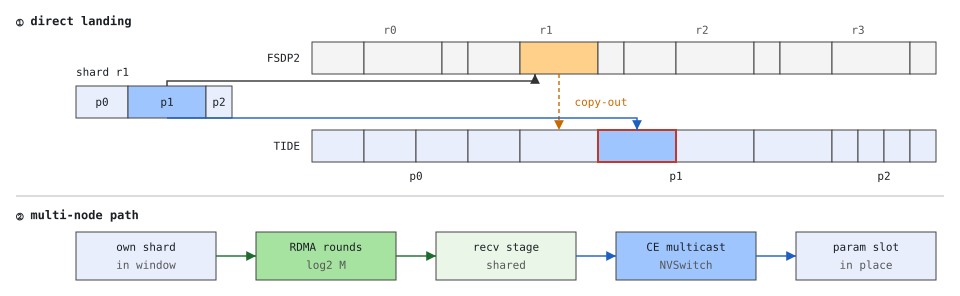

# TIDE-AG design



## 1. Semantics

A layout-aware all-gather over one arena region. The caller supplies a byte table
`sizes[p]`, `offsets[p]` (offsets = prefix sums of sizes; the shard is segment-ordered).
For nranks = N and rank r, the piece of segment p contributed by rank r lands at

    region + offsets[p] * N + r * sizes[p]

so all N pieces of one segment are contiguous (parameter-major). Equivalent to P
standard in-place all-gathers issued as one group; the copy-out permutation of a
rank-major all-gather is folded into the landing addresses.

Correctness is defined against the reference `stock all-gather + permutation`
(`tide.testing.param_major_permute`), byte for byte.

## 2. Layers

```
tide.fsdp              FSDP2 adapter: eligibility, slots/arena, sharded params in the arena, bind-once views
tide.comm / tide.table TideComm, AgHandle, byte tables            (python, torch-aware)
csrc/collective/ag     AgPlan: prebuilt descriptors, bins           (host C++)
csrc/runtime           Comm: NCCL comm, windows, peer ptrs, flags   (host C++, no kernels)
NCCL 2.31 public API   ncclCommInitRankConfig, ncclMemAlloc, ncclCommWindowRegister,
                       ncclGetPeerDevicePointer, ncclCommQueryProperties, [ncclPutSignal/WaitSignal]
CUDA                   cudaMemcpyBatchAsync (copy engines), cuStreamBatchMemOp / cuStreamWriteValue32
```

The transport layer never sees a framework object; the adapter never sees NCCL.

## 3. Objects and lifetimes

| When | What | API |
|---|---|---|
| once per process group | `TideComm`: dedicated `ncclComm_t` (unique id broadcast over torch), `ncclCommQueryProperties` gate (`deviceApiSupport` required), sync window, copy stream(s) | `ncclCommInitRankConfig`, `ncclMemAlloc`, `ncclCommWindowRegister(NCCL_WIN_COLL_SYMMETRIC)`, `ncclGetPeerDevicePointer` |
| once per arena | `alloc_arena(bytes)`: one `ncclMemAlloc` block, registered once, never grows; cross-rank size check | same |
| once per region (FSDP group) | `register_ag(arena, region_off, sizes, offsets[, stage_off])`: cross-rank table check, `AgPlan` with every `(peer, segment)` descriptor precomputed; multi-node: the stage area is mapped to a credit channel (areas that overlap share one) | none |
| every call | `all_gather(handle, stream)`: four fence memop batches + one copy batch, zero kernels, no NCCL calls (single node); multi-node adds the host-RMA rounds below | CUDA only / `ncclPutSignal`, `ncclWaitSignal`, `ncclSignal` |

Registration is collective and happens at install time; the arena is sized by the
adapter's lane plan and asserted identical on every rank (peer addresses are
`peer_base[q] + offset`, so every rank must use the same offsets).

## 4. Per-call protocol (single node, implemented)

All on the caller's stream `s`; `k` is a per-comm monotonically increasing 64-bit sequence.

1. `ready[r] := k` in every LSA peer's sync window: one `cuStreamBatchMemOp` batch of
   WRITE_VALUE_64 to the peer-mapped addresses (the GPU front end writes them; a copy-engine
   write would queue behind a running scatter).
   Meaning: my region is free to be written into (the caller ordered `s` behind the
   release of the previous tenant of this lane) and my own pieces are in place.
2. `cuStreamBatchMemOp` WAIT_VALUE_64 GEQ k on `ready[q]` for every peer q.
3. `cudaMemcpyBatchAsync` of the prebuilt descriptors: one copy per segment to the multimem
   address of the landing slot; the switch replicates it into every LSA rank's window, self
   included (P descriptors). The window must be NVLS-bound (a unicast push, 7P descriptors with
   the peer order rotated by rank, is not provided).
4. `done[r] := k` in every peer's window; 5. wait `done[q] >= k` for every peer.

No self copy and no copy-in: the packed shard is read where it lives (`own_off`: the sharded
parameters themselves in the adapter). No same-device D2D copy exists on the path.

Safety argument (ping-pong lanes, FSDP schedule): peers write into my lane only after
my `ready(k)`, which follows my compute's release of that lane; I read my lane only after
`done(q) >= k` from every peer. Verified by `test/test_fence.py` (a slow consumer detects the
corruption when the entry wait is disabled; a slow writer detects it when the exit wait is).

Contract: every rank issues the same sequence of calls on one comm, from one stream. The
flags carry the sequence number only, as NCCL's own CE collectives do; the order is the
caller's (FSDP's) responsibility.

## 4b. Multi-node rounds (implemented)

`M` nodes, `L` ranks per node, ranks node-major; rank `r`'s rail peer on node `m` is
`m*L + r%L`. The stage area holds `M` slots of `S` bytes at the same window offset on every rank.

### Recursive doubling (the multi-node protocol)

Stage slot `i` holds the shard of my rail peer on node `(n + i) mod M`; the caller writes its own
packed shard into slot 0. Round `r = 0 .. ceil(log2 M) - 1`: put slots `[0, cnt)` -- everything
held so far -- to rail peer `n - 2^r`, whose slots `[2^r, 2^r + cnt)` they are, and receive the
same block from `n + 2^r` into my slots `[2^r, 2^r + cnt)`; `cnt = min(2^r, M - 2^r)` (Bruck's
partial last round for non-power-of-two `M`). A round's put forwards the previous round's arrival,
so it follows it by stream order; one incoming and one outgoing flow per NIC per round; the same
`(M-1) S` bytes as the rotation in `ceil(log2 M)` rounds instead of `M - 1` (6 instead of 63 at
64 nodes: every round costs ~0.1 ms of launch and arrival detection and ~0.13 ms of host time,
which the rotation pays 63 times). Each received block is
scattered as it lands: consecutive slots are consecutive rail-peer ranks, so a segment's pieces
are one strided descriptor per run of node indices (two at the wrap; `copy.h`, strided from 4
rows on). The last round goes in `TIDE_NIC_GROUPS` ranges of whole slots, each scattered as it
lands. Pacing as below with the doubling's peers: the put of round `r + 1` waits for `to`'s signal
that its round `r` landed (heads), and my round `r + 1` source is signalled once my round `r` heads
landed. Credits: one per source per call, once every slot is scattered and no longer a put source.
Steps `2^r` are distinct and below `M`, so no two rounds share a source or a target and the
cumulative signal counters stay in lockstep.

Measured against the rotation on six nodes (three interleaved pairs, min of 30, both with
`TIDE_NIC_GROUPS=2`): 32 MiB 4.05-4.19 vs 4.22-4.34 ms, 128 MiB 15.30-15.34
vs 15.10-16.05; medians 4.2-4.4 vs 4.3-5.6 and 15.3-17.0 vs 17.0-21.2 (fewer rounds, less jitter
exposure); host per call 226-287 us vs 356-681 (one segment), 490-609 vs 543-824 (30 segments), and
the pipelined host maximum 0.3-0.7 ms vs 4-37 ms (the rotation's launches back up on the queue).
Three nodes: identical (two rounds either way). Bitwise at 2, 3, 4, 5 and 6 nodes (the partial
last round at 3, 5, 6). With the last round in one range the doubling was slower (4.36 / 16.65:
its last round carries half the shards and their scatter was exposed), hence the groups default.

### Rotation (M-1 rounds; replaced by recursive doubling, not in the code)

The caller writes its packed shard into stage slot `[node]`.

1. `ready` as above. If this stage area was used before: `ncclWaitSignal` for one
   credit (signal index `2 + slot`, context 0) from every rail peer — they have scattered my
   previous shard out of their slot `[node]`.
2. Wait `ready` from the LSA peers; fork `ceStream`; scatter my own slot into the landing
   (multicast: one write lands on all `L` windows).
3. Round `j = 1..M-1`: `ncclGroupStart`; `ncclPutSignal` chunk `c` of my slot into rail peer
   `(node+j)`'s slot `[node]` on context `c` (one chunk per context, one QP each); `ncclGroupEnd`.
   `ncclWaitSignal` one arrival per chunk from rail peer `(node-j)` (its round `j` sends to me).
   On `ceStream`: scatter slot `[node-j]` into the landing. At any time a NIC has one incoming and
   one outgoing flow (no incast).
4. Join `ceStream`; one `ncclSignal` credit to every source (grouped, on `s`); `done` as above.

Why credits are per stage area and not per plan: NCCL signals are cumulative counts per
(peer, index, context), so "the k-th wait matches the k-th signal" holds only if waits and
signals are issued in lockstep. Groups sharing one stage area (FSDP ring slots) issue the
same cumulative sequence of puts into it, whatever their interleaving; per-plan bookkeeping
would let a put pass on an older credit (caught by `test_fence.py --pattern burst` with
`TIDE_FAULT=nocredit,slow`).

Costs on the host per call: one credit wait, `M-1` grouped puts, `(M-1)*ctx` arrival waits,
one grouped credit signal (each a NCCL plan launch), plus `M*P` scatter descriptors. The
`ncclPutSignal` stream semantics include local completion, which coincides with the
arrival of the round's incoming shard, so it costs only the completion-detection latency.

Measured on 6 nodes x 8 GPUs with 400G single-port RoCE rails (128 MiB/rank: 5 rounds x 2.8 ms NIC +
1.4 ms exposed last scatter = 15.3 ms):

- NCCL orders every operation of a communicator through one internal stream
  (`enqueue.cc`: the launch stream waits on `deviceStream`, which then advances to the launch's
  completion). A credit signalled from `ceStream` right after each scatter therefore made the
  next round's put wait for that scatter: 5 rounds x (NIC + scatter) instead of overlapping.
  Hence all NCCL calls on the caller's stream, credits once per call.
- The fences are stream memops written straight into the peers' windows. As copy-engine writes
  they queued behind a running scatter and a late `done` flag stalled every rank.
- Per-call minimum equals the paper account, but the mean had a heavy tail (p90 26 ms) with
  ~1-2 M ECN-marked packets and thousands of CNPs per rail per run: a node one round ahead puts
  a second flow into a port that is still receiving, DCQCN throttles both, the lockstep chain
  spreads the delay. `TIDE_NIC_PACE` makes round j+1's source wait for "round j landed": ECN
  marks drop 100x, p90 26 -> 18 ms. On a second fleet (six nodes across three subnets)
  the unpaced 32 MiB median itself collapsed (6.7 ms vs 4.0 on the first fleet, 10 M ECN marks
  per run), so `auto` now paces every shard of at least two leads. The pace signal's true cost
  at the minimum is ~0.03 ms per round ((4.14 - 3.98) / 5 at 32 MiB), not the 0.12 ms first
  estimated; `TIDE_NIC_PACE_LEAD_MIB` (8) sends the signal while the round's last bytes are still
  in flight, which did not move the median (noise band) but cut ECN marks another 7x (107 k ->
  16 k) and the p90 at 128 MiB (19.4 -> 16.4 ms) at +70 us host per call (one more put per
  context). Kept as default for the fabric's sake, not for speed.
- `TIDE_NIC_GROUPS` (default 4, at most the last round's slots) sends the last round in G sequential ranges and
  scatters each as it lands, trimming the exposed tail (rotation, G=2: 15.3 -> 14.7 ms minimum;
  doubling, whose last round carries half the shards: 32 MiB 4.36 -> 4.06, 128 MiB 16.65 -> 15.33
  against the rotation's 4.25 / 15.7). Applied to every round it added a handoff per range and
  G >= 4 measured worse at 6 nodes (the last round there has only two slots), hence last round only.

Six-node table, one quiet window, 30 rounds (min / median ms per all-gather, 48 ranks, 400G
single-port rails). The comparison with what FSDP2 pays (the collective plus its copy-out, as one fused
copy) is in [benchmarks.md](benchmarks.md#all-gather-against-fsdp2s-options-18-nodes).

| per-rank shard | TIDE (4 ctx) | NCCL 2.31 default algorithm |
|---|---|---|
| 32 MiB  | 4.25 / 4.40 | 4.71 / 4.73 (p90 8.8) |
| 64 MiB  | 7.96 / 8.38 | 8.87 / 9.26 (p90 14.5) |
| 128 MiB | 15.63 / 15.98 | 17.24 / 22.6 (p90 32.8) |

At 32 MiB the all-gather already runs at the 400G line rate, so there is no bandwidth to win there.
NCCL's own algorithm choice is within 7% of TIDE at the median but has a heavy tail. TIDE's 30-segment
rows equal its 1-segment rows (4.25 / 4.75 at 32 MiB).

## 5. Measured design decisions (8 GPUs per node, NCCL 2.31.2)

- Multicast landing: CE writes to the NVLS multimem address are zero-SM (nsys: PtoP/DtoD
  kinds, 0% SMs Active), correct in-place and staged, legal down to 192 B pieces, and
  independent of segment count (1/16/64 segments all 0.72 ms at 64 MiB/rank; 654-675 GB/s
  busbw, ~10% below unicast push). Descriptors P instead of 7P, source egress 1x instead
  of 7x. Chosen as default; tail bundling is therefore unnecessary intra-node.
- Peer order rotation (push): without it every rank targets peer 0 first (all-to-one hot
  spot), a copy engine delivers ~230 GB/s; rotated, one stream reaches 735-760 GB/s
  (the NVLink PtoP write ceiling measured independently). One copy stream: 2/4/7 streams measured
  equal or slower, so the multi-stream fan-out was removed.
- Push beats pull (pull 190-340 GB/s); pull mode was removed.
- `cudaMemcpyFlagPreferOverlapWithCompute`, ncclMemAlloc vs plain cuMem properties:
  no effect on PtoP throughput.
- `cudaMemcpyBatchAsync` rejects the legacy NULL stream: per-op fallback exists; callers
  should use a side stream (FSDP does).
- A copy-engine write to a multicast address gates kernel launches in its context: while one
  is in flight, the next kernel on any stream of the process starts only when the copy ends
  (nsys, 8 ranks: victim kernel duration 82 -> 89 us, launch gap 7.7 -> 280 us; unicast P2P
  copies 18-29 us). The stall is the length of the individual copy (the batch is issued as one
  copy per copy engine; 16 per-descriptor `cudaMemcpyAsync` of 2 MiB each: +27% instead of
  +154% on a 256 MiB elementwise victim), only the issuing process is affected, and memop waits
  are not the cause (`TIDE_FAULT=nowrite` +2%). It does not reproduce in a 48-rank FSDP training
  run: the compute stream keeps launching inside the landing copies (2.2 vs 1.7 kernel starts/ms
  trace-wide), and a unicast push landing was not faster end to end, its host call lasting the whole
  operation past ~30 segments. Multicast is the landing.
- Host cost ~1 us per descriptor (multicast: 33/62/96 us for 1/30/64 segments; push:
  42-760 us). CUDA-graph replay measured slower (56/124/208 us; exec node patching + per-node
  launch cost exceed the eager batch API) and was removed. The arena allocation variants
  (posix/fabric handles, GDR flag) measured no difference and were removed too.

## 6. Multi-node data path and what it was measured against

Two hops per byte: NIC once (rail-aligned put of the whole packed shard to the same-index
GPU on every other node, no relay, no per-segment fragmentation), NVLink once (the rail peer
multicast-writes the landed shard into all local windows, itself included). Per-rank NIC
bytes `(M-1)*S`, NVLink ingress `L*M*S`; on 400G single-port rails the NIC is the bound.

Measured on the way here (8 nodes): NCCL's own hierarchical CE all-gather (all `M-1` puts at
once) collapses under RoCE incast from 4 nodes (503 -> 261 GB/s busbw at 8 nodes, ECN storms),
which is why rounds are paced 1:1. Gate for the NIC leg: within 5% of the rail line rate on the
same fabric.

Not built, on purpose: tail bundling (unnecessary intra-node with multicast, and the NIC leg
already sends one put per peer) and CUDA-graph replay (measured slower than the eager batch).

## 6b. FSDP2 adapter (`tide/fsdp.py`, implemented)

Contract wrapper around `foreach_all_gather` / `foreach_all_gather_copy_out` (captured as found
at `install()`, so it wraps other patches and `uninstall()` restores them; the arena is freed
then and a later `install()` allocates anew -- freed credit channels are reused with their
counters); slots = landing
+ receive stage at fixed offsets; the sharded parameters moved into the group's packed shard at
binding (`_repoint`: `_sharded_param_data` and the DTensor's local tensor become window views, as
FSDP2's own `reset_sharded_param` does when a storage changes; the cast path keeps its kernel;
`uninstall()` moves them back; a call refuses a shard whose storage moved since); bind-once landing views (own storage so `as_strided(storage_offset=0)` works);
groups that keep their parameters unsharded (including the root when FSDP's lazy init decides
so) get dedicated slots. Ring slots: two (ping-pong). With prefetch depth 1 the computing group
and the prefetched one are the only unsharded ones, the slot a prefetch takes was released
before the prefetch was issued (post-forward(i-1) precedes pre-forward(i); post-backward(i+1)
precedes pre-backward(i)), and consecutive groups alternate slots whichever way the layers are
traversed, so no all-gather ever waits on a slot. Four slots "for margin" would cost 2 x the
largest group of memory for nothing. Dim-0 groups on the comm's process group (with
`subgroups=True`, also on regular subsets of the ranks); a parameter with an all-gather extension
lands one segment per input, copied in at every call; offload, post-forward meshes and other groups
decline to the stock path.

## 7. Knobs (env)

`TIDE_STRIDED_ROWS` (4; destination rows from which one strided descriptor replaces flat ones, 0 =
flat only; `copy.h`), `TIDE_COMM_CTAS` (channel cap of the NCCL communicator, default 1, 0 = NCCL's default),
`TIDE_NIC_PACE=auto|0|1` (per-round pacing of the inter-node leg; `auto` paces shards of at least
two leads), `TIDE_NIC_PACE_LEAD_MIB` (default 8: bytes of a round still in flight when the pace
signal leaves, 0 = signal only after the whole round), `TIDE_NIC_GROUPS` (sequential ranges the
last round is sent and scattered in, default 4; doubling: ranges of whole slots),
`TIDE_FAULT=nowrite,nofence,nodone,nocredit,noscatter,slow` + `TIDE_FAULT_RANK`/`TIDE_FAULT_US`
(tests only; compiled in by `scripts/build.sh` / `TIDE_FAULT_INJECTION=1`, absent from a plain
install, which refuses to start with `TIDE_FAULT` set).
Per-communicator: `num_rma_ctx` (QPs a shard is striped over, default 4; `TIDE_RMA_CTX` overrides), `num_rma_sig`
(2 + credit channels, default 64).
Fewer contexts cost bandwidth: on six 400G single-port nodes one context runs the 32 MiB all-gather
in 7.2 ms against 4.5 with four (rounds are short puts with head/tail splits and pace waits, so one
QP never has enough in flight). Each context is also another launch per round (NCCL schedules one
RMA plan per context), which is why `num_rma_ctx=1` plus `TIDE_NIC_PACE_LEAD_MIB=0` can help where the
all-gather is hidden behind compute and only its host cost shows. Use that setting only in that
situation.
Sweep on six 400G nodes (32 / 128 MiB, min ms): 1 ctx 7.6 / 19.6, 2 ctx 4.5 / 15.5, 4 ctx 4.4 / 15.4,
8 ctx 4.4 / 15.5 -- but with 8 contexts the host call itself lasted the whole operation (4.4 / 15.5 ms
instead of ~0.4), so 8 cannot overlap compute; 4 stays the default. Without the pace lead
(`TIDE_NIC_PACE_LEAD_MIB=0`) the same fleet and window measured +32-47% at the median and +50% at p90.
`TIDE_TRACE_AG=1` records a timing event per phase of every multi-node call on the caller's stream
(start, credits, fence, each round, scatter join, done); `comm.trace_ag()` returns the completed calls.
Reading it: with two ring slots and the entry fence, ranks may run up to one layer out of phase, so a
leading rank shows one phase (fence or the round that exchanges with the lagging node) ≈ a whole layer
period -- that is the normal shape, not a slow all-gather. The pacer is the rank whose total is smallest
and whose node-mates wait at the fence.
