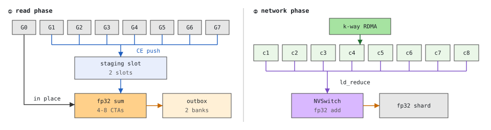

# TIDE-RS design



## 1. Semantics

`reduce_scatter(grads: list[Tensor]) -> packed fp32` over FSDP2's unsharded gradients read in
place: gradient p has `numel` elements in `dim0` rows, rank q's piece is rows
`[q*rows, (q+1)*rows)` with `rows = ceil(dim0 / nranks)` (elements past `numel` are padding, zero),
and the output is the concatenation of this rank's pieces, segment-ordered -- byte for byte the
layout of `torch._chunk_cat(grads, dim=0, num_chunks=nranks)` followed by `reduce_scatter_tensor`.
Input bf16 or fp32 (contiguous, same dtype); accumulation fp32; `out = (accumulate ? out : 0) +
scale * sum`, so AVG (`scale = 1/nranks`) and gradient-accumulation microbatches (`accumulate`)
are fused into the landing. The sum order is fixed per rank (staged slots in order, then the own
piece; cross-node partials by node order), so results are bitwise reproducible run to run (measured;
the NVSwitch's reduction order is deterministic in our measurements, though not specified by NVIDIA);
integer-valued inputs are bitwise equal to stock, real inputs are checked against an fp64
reduce-scatter (`test/test_rs_bitwise.py`).

No input window, no chunk_cat, no producer contract: the design consumes what autograd
produced. The window-resident design this replaces needed an fp32 symmetric input
window (+G bytes resident, G = one group's full fp32 gradient) and producer kernels writing into
its geometry so that NVLS `multimem.ld_reduce` could do the 8-way add; with bf16 autograd input
that path either loses precision (multimem returns bf16) or needs an SM cast copy larger than
the add itself. The add therefore runs on a few CTAs here; what stays zero-SM is every byte of
transport.

## 2. Data path

```
every rank      CE: my bf16 pieces for the 7 other local owners  ->  their staging slot        (cudaMemcpy3DBatchAsync, peer window)
                memop: land[slot][me] := u  in the 7 owners' flag windows
owner           memop: wait land[slot][*] >= u          (the 7 pushes for this chunk have landed)
                K_sum: fp32 sum of 7 staged pieces + own piece (read in place)                  (rsSumStream_, TMA-streamed)
                memop: free[slot][me] := u  in the 7 sources' flag windows   (slot reusable)
NIC rounds       K_sum of sub-slice (me + c) mod L of the k destination nodes of the round  ->  outbox blocks
(k-way)          ncclPutSignal to their rail peers' inbox block of the current wave's parity; the round's partials for me land
                 ncclWaitSignal (heads), `release` to the next round's sources, tails
wave complete    memop: waveReady[parity][me] := seq;  wait waveReady[parity][*] >= seq  (the 8 local owners' blocks are in)
                 landing on rsAddStream_: out (+)= multimem.ld_reduce over the parity's 8 blocks (fp32 add in the switch)
                 memop: waveDone[parity][me] := seq;  a reused parity is released only after waveDone[parity][*] >= seq
last wave        K_sum of my own node's partial into my inbox block (from wave 2 on: into a spare block, copied in on the
                 caller stream once the parity's previous wave landed), then its landing (x scale, += out)
end              `release` to the next call's first-round sources; blocks the parities' last waves fed are zeroed (CE)
```

Single node: one K_sum straight into `out`. All NCCL calls stay on the caller's stream; kernels
and copies run on internal streams joined back before the call returns (the caller may
free the gradients at the returned event). Every wait is a stream memop or a signal wait: no
SM spins on a peer, rank skew costs no SM time.

The level-1 pushes rotate over 4 CE streams, one per chunk-round (slot order still comes from the
`free`/`land` flags). A stream holds only ~1000 queued copy descriptors; one stream held a whole
8-node call's M·7·P strided pieces, so a call queued behind a long backward kernel blocked the
issuing thread until that kernel drained (host 0.58 ms flat vs gap + 7..120 ms before; 8 nodes).
Handing the issue to a thread instead deadlocks:
the caller stream's wait for the thread's completion value can share a hardware queue with the
streams that produce it.

### Staging (window-relative, same offsets on every rank)

`[local staging: S slots x L sources x L destinations x chunkBytes] [inbox: 2 parities x L blocks]
[outbox: O blocks] [own spares]` (block = `[l][partElems]` fp32; single node: staging `[source][chunk]` only), chunk =
`TIDE_RS_CHUNK_MIB` (16) of input per source; a node round is processed in `chunks` chunk-rounds
rotating over the S = `TIDE_RS_STAGE_SLOTS` (2) slots. With two, a slot's next push waits for the whole
team's sum of the chunk-round before (8 nodes, 37 MiB chunks: the pushes go in pairs and the reads end at
~55 ms for ~34 ms of pushes); more slots let the pushes run ahead of the sums, at a slot's bytes each
(under the FSDP2 adapter at 8 nodes four slots measured within noise of two in both modes, for 8 S more memory,
so two is the default and four stays a knob).

Passes (`TIDE_RS_PARTS`, n; partElems = subElems / n): a wave's partials must all be in the inbox before
its landing, so with one pass the inbox holds L whole sub-slice blocks per parity -- 8 S, 4.6 GiB at 8 nodes x
S = 592 MiB. n passes run the NIC rounds and waves once per part of every sub-slice, waves numbered along the
call: two parities from n = 2 on (part q + 2 reuses part q's parity under the same waveDone / `release` rules),
a part's first wave writing its elements, zero masks against the previous wave of the parity. An element's
waves land in the same order in whichever pass carries it, so the result is bitwise the one-pass result.
Refused (n = 1) when a wave holds the own node alone (M = 1 mod the wave size): that wave has no rounds, and
the next pass's first rounds would wait for its landing before it is issued. The head (first partial) and
tail (last landing) shrink to 1/n -- 8 nodes, S = 592 MiB, k = 1: minimum 102 -> 94 ms at 4-8 passes -- but each
pass is a full set of NIC rounds and staging chunk-rounds, a few stream memops each that the host queues
~300 ms ahead of the GPU; in training 4 passes at k = 1 (28 rounds) blocked the host in `cuStreamBatchMemOp`
(+1.1% step), 8 passes (56) +8.8%, while 4 at k = 2 (16 rounds) did not (inbox + outbox 5.8 -> 2.9 GiB). The
solver takes 4 passes at k = 2 once the inbox of whole sub-slices reaches 2 GiB. Flags live in a separate window: `[area][land|free|waveReady|waveDone][slot][rank]`
uint64, monotonic counters (the AG's `writeFlags/waitFlags`). Slot reuse is gated by the owners' `free`
flags; inbox reuse (parity and call) by the `release` signal (index from the top of `num_rma_sig`, one
per stage area). Stage areas that overlap share an area and one geometry (`rs_area_bytes`); they may not
touch any all-gather landing or stage, and vice versa.

### Descriptor waves

The push is the host's main cost: one copy descriptor per (owner, segment, destination), 7 P M per
call (672 at 6 nodes x 16 segments). Along the destination axis the descriptors are strided: for
one (owner o, segment p) the pieces of destinations t·L+o sit L·pieceElems apart in the gradient,
and if the staging holds those destinations at a constant pitch, one `cudaMemcpy3DBatchOp` (rows =
destinations, source pitch = L·pieceElems·itemsize, staging pitch = the per-destination slot)
covers them all; the padded tail of a segment shortens the last live row and drops the rows after
it. Measured (8 GPUs, CUDA 13.2, `copy_api_cost.cu`): a flat `cudaMemcpyBatchAsync` descriptor
costs the host 0.75 us and the batch spreads over the copy engines (501 GB/s at 1 MiB ops); a
`cudaMemcpy3DBatchAsync` op costs 1.7 us whatever its row count and runs one op at a time (1 row
196 GB/s, 2: 314, 3: 391, 4: 442, 8: 559). So a run of destinations becomes one strided op from 4
rows on (`TIDE_STRIDED_ROWS`, 0 = flat only) and stays flat below.

- **Multicast mode** (§6b, the default with NVLS): the slot already holds the L destinations of a
  node round at pitch `chunkBytes`, so one op per (owner, segment) per round replaces L flat ones
  (7 (P+L) M -> 7 (P/L+1) M): 6 nodes, `--sync-each` host 2.0 -> 0.8 ms (16 segments) and 3.6 -> 1.2
  (30); latency +0.1 ms at 32 MiB (min 4.7 vs 4.6, interleaved A/B x3: the strided ops run one at a
  time on the copy engine, each paying its setup latency) -- the NIC leg bounds the rest.
- Pushing several destinations before summing them (a chain of SM adds with destination waves)
  cost latency (+28% at 6 nodes); the k-way rounds + wave landing pace the pushes by round instead.

### k-way rounds (`TIDE_RS_KWAY`)

The M-1 remote destinations go out in rounds of k targets (`Comm::putRounds`: the k puts in one
NCCL group, the heads of the k sources awaited together, one pace signal to each of the next
round's sources, then the tails), so 127 destinations at 128 nodes take 21 rounds at k = 8
instead of 127, which would cost 127 launch-and-detect latencies (~0.1 ms each) and ~20 ms of
host time. The round sizes ramp 1, 2, 4, .., k, plateau, and ramp
down to 1: K_sum yields one partial per about one partial's NIC time (4 CTAs at 400G), so a first
round that waited for k partials would idle the NIC for k-1 of them and a k-wide last round would
expose k-1 transfers after the last sum. Each port carries k incoming flows per round, each paced
by the previous round's landing; the ceiling of k is the fabric's ECN behaviour (at 16-17 nodes k = 8
did not collapse under 8:1 incast and beat k = 2 at the median and p90). The outbox ring holds two consecutive rounds (destination j sums into
block j % O, its inbox block on the target by the Latin-square rule). Rounds are aligned to the
landing waves (§6b: the first wave ramps up, the last ramps down, no round straddles a wave).
The extension's default is k = 2. The solver (`tune_rs`, which the FSDP2 adapter calls) starts from k = 2
and doubles it while the rounds' waits exceed 10% of the NIC time and doubling cuts rounds, up to 4 (the peers
the device network phase's tables hold): a round waits ~1.3 ms for its peers' credits whatever it carries
(64 nodes, device trace), so with many nodes the rounds, not the bytes, set the network phase. 64 nodes x a
74 MiB fp32 output: k = 4 in 19 rounds beat k = 2 in 33 by 4-5%; 8 nodes x a 592 MiB one: k = 2 in 4 rounds
beat k = 4 in 3 by 6-8% (each round's transfer is long there, a wider round only adds incast). With host-driven
rounds at 16-17 nodes k = 8 beat k = 2 at the median by 0-30% and at p90 by 12-45% with no incast collapse;
k = 8 is one full wave per round, 20 rounds at 128 nodes (`TIDE_RS_KWAY=1` is the per-destination protocol).
Small fleets are cut by the ramp (k <= M - 1); at 6 nodes k changes nothing that can be measured but ECN
counts, and 8:1 incast needs >= 9 nodes.

### Byte account per rank per call (S = fp32 output bytes, M nodes, L = 8)

| link | bytes | 6 nodes, S = 32 MiB, 400G |
|---|---|---|
| NIC out = in | (M-1) S (fp32 partials) | 160 MiB, 3.5 ms at 47.5 GB/s |
| NVLink (CE, bf16 pieces) | 7 M S / 2 out, same in | 672 MiB, ~0.9 ms at 750 GB/s |
| SM read | K_sum 8 x S/2 per destination x M + landing S per wave (through the switch) + out S per wave | (4M + 2W) S |
| SM write | K_sum S x M + landing S per wave | (M + W) S |

The rail leg is the all-gather's (`num_rma_ctx` striping, `TIDE_NIC_PACE`, per-area credits); NVLink direction is complementary to the all-gather (multicast lands as
ingress, pushes leave as egress). NCCL orders all RMA of one communicator through one internal
stream, so an all-gather and a reduce-scatter on the same TideComm time-share the NIC in program
order (one flow per port per direction) instead of racing.

## 3. Kernels and the CTA budget

`csrc/collective/rs/kernels.cu`. `rsSumTmaKernel<T, kFull>`: each CTA owns a contiguous tile
range (8 KB per source per tile; 16 consumer warps for bf16, 8 for fp32, one 16 B vector per thread
per source) plus one producer warp. The producer streams the 7 staged sources into shared memory
with `cp.async.bulk` (3 stages x 7 x 8 KB, `full` mbarriers with `expect_tx`), refilling a stage
once every consumer warp has arrived on its `empty` mbarrier, and writes one descriptor per tile
(segment, real/written counts and own/output pointers at the tile start, all warp-uniform unless a
segment boundary falls inside the tile) into a 6-deep ring guarded by `desc` mbarriers; there is
no block-wide barrier in the loop. Consumers turn a descriptor into their vector's metadata with an
add and two clamps (the per-vector segment lookup remains as the fallback for straddling tiles),
prefetch the own piece four tiles ahead as raw bits, and accumulate bf16 straight into fp32 with
`add.rn.f32.bf16` (sm_100+, one instruction per element and bitwise equal to convert + add;
`kFull` = L == 8 makes the source loop compile-time). The plain-load versions it replaced (removed; TMA is
required, sm_90+) taught three lessons: a decoded-float
array indexed by a runtime source id lands on the local stack; a warp must read 512 contiguous
bytes per load (consecutive threads, consecutive vectors); predicates must be 32-bit.

Measured per CTA, first kernel version: K_sum 32 GB/s, K_add 43 GB/s (LDG versions 26-29). That
was not the SM's streaming floor: an idealized 8-source sum with the same TMA structure
streams 75 GB/s per CTA with 8 warps and
122 GB/s with 16 warps, and plain loads with everything issued before use reach 84-95. ncu on the
real kernel with 8 warps showed 28% issue utilization = two warps per scheduler each waiting ~7
cycles per instruction (long-scoreboard on the own-piece loads, barrier, TMA wait), i.e.
latency-bound for want of warps. Now bf16 runs 16 warps per CTA (one 16 B vector per
thread per source per 8 KB tile), the own piece is prefetched four tiles ahead as raw bits, all
shared-memory loads of a tile are issued before the first add (compile-time source count). Single
node, 32 MiB, push + sum: 4 CTAs 1.48 -> 1.11 ms, 8 CTAs 0.85 -> 0.66, 12 CTAs 0.52 -> 0.51
(kernel alone ~46 GB/s per CTA; issue utilization 44%). Then, same day, four more cuts measured on
the kernel itself (ncu, 4 CTAs, 32 MiB single node; GB/s = 7 staged + own read + fp32 write):
producer-warp tile descriptors instead of per-vector segment lookups 63 GB/s per CTA (348 -> ~210
instructions per warp-tile); `add.rn.f32.bf16` + compile-time source loop 75; incremental (l, tile)
cursors instead of a 64-bit division per tile in the producer 80 (the serial producer thread had
become the critical path: barrier stalls 2.8 of 11 cycles); `full`/`empty`/`desc` mbarriers instead
of a per-tile `__syncthreads` 93 (barrier stalls 0.01); plain-store fast path (scale 1, no
accumulate) and explicit `st.global` 99. Remaining gap to the 122 GB/s microbench: the compiler
serializes LDS -> adds -> LDS on two register quads (short scoreboard) and the store's source
registers are held until the store drains (long scoreboard on the first overwrite); pinning the
loads live did not change the schedule. Single node, 128 MiB out/rank, push + sum: 4 CTAs
3.99 -> 2.04 ms, 8 CTAs 2.13 -> 1.18. Six nodes, 32 MiB (min of 30): 4 sum CTAs 5.39 -> 4.81 ms,
6 -> 4.68, 8 -> 4.60, i.e. the NIC pace is now met with 4-6 sum CTAs where it took 8-12; with the
multicast landing the add side is 8 CTAs on the tail only, so peak concurrency is the sum CTAs
alone. What remains on the SM side is that these CTAs
never spin on a peer (a kernel-driven collective's CTAs wait out the slowest rank), that stock's
chunk_cat (a whole-GPU kernel writing the fp32 copy) is gone, and that no G-sized window exists.

## 4. Overlap with compute and standalone latency

Full 1–8 node latency, memory, and overlap tables are in [docs/benchmarks.md](benchmarks.md). Two mechanisms govern
compute interference when a reduce-scatter runs concurrently on its own streams (`bench/interference.py`):

- **Wave quantization on one-wave GEMMs.** A small-M GEMM (256 x 8192 x 8192, 128 CTAs with 213 KB shared memory per
  CTA, one per SM) fits the GPU in a single wave; 16–32 resident NCCL CTAs cannot co-reside with a GEMM CTA and push
  the GEMM into a second wave (+68–71% at 8 nodes, with NCCL's default kernel, capped at 8 CTAs, or behind FSDP2's
  packing), whereas TIDE's sum CTAs (4 or 16) and 1–4 landing CTAs leave it in one wave (+1.3–2.9%). Capping NCCL at
  4 CTAs does too, at about four times its reduce-scatter latency. MoE grouped GEMMs with small M have this shape.
- **HBM bandwidth on memory-bound kernels.** Elementwise kernels see the HBM traffic of the local sum, which grows
  with the sum CTA count (+0.6–1.6% with 4–16 sum CTAs, against +7–14% for NCCL's default and symmetric kernels and
  FSDP2's two paths; 4 sum CTAs keep pace with a 400G rail).
  In the reverse direction, a persistent GEMM that occupies every SM delays any co-running kernel until a kernel
  boundary regardless of stream priority; only an SM reservation avoids that.

## 5. Knobs

The first four are set by `TideComm.tune_rs` (`tide/solver.py`: sum CTAs from K_sum GB/s per CTA against
the NIC, landing CTAs from the last wave's tail budget, k from the per-round fixed cost within the
incast ceiling, the chunk from the stage-area budget, at most 8 MiB on multi-node -- a chunk-round costs host
issue time, not device time) unless set in the environment; the defaults in
parentheses hold when nothing tunes the communicator.
`TIDE_RS_CTAS` (4, 8 on a single node; K_sum), `TIDE_RS_MC_CTAS` (4; one wave's landing), `TIDE_RS_WAVE_NODES` (8; nodes per
landing wave), `TIDE_RS_KWAY` (2; destinations per NIC round, ramped within the first and last wave),
`TIDE_RS_CHUNK_MIB` (16; the chunk count is the one nearest to span/hint, so a chunk may grow to 1.5x
the hint), `TIDE_RS_PARTS` (1; passes over the sub-slices, see Staging), `TIDE_STRIDED_ROWS` (4; destination rows from which one strided descriptor
replaces flat ones, 0 = flat only), `TIDE_RS_RAIL_PARTS` (4; one rank per node:
the rounds run once per staging part, so the inbox / outbox blocks hold 1/n of a piece; same results),
`TIDE_RS_CHECK_ORDER` (0; debug: cross-rank
check of (handle, call index) on every call), `TIDE_RS_DEBUG` (0; 1 serializes phases, 3 prints host time per call by category, 2 dumps flags
on a stall), `TIDE_NIC_PACE` / `TIDE_NIC_PACE_LEAD_MIB` / `num_rma_ctx` / `num_rma_sig` as for the
all-gather; `TIDE_FAULT=nowrite|nofence|nofree|nocredit|nodone|nozero|slow|slowsum|slowpush` (tests;
build-time `TIDE_FAULT_INJECTION=1`).

### Contracts and limits

Ranks are node-major and the NVLink domain has at most 8 ranks (`kRsMaxLocal`; the kernels hold one
source slot per local rank, registration refuses wider teams). Every rank issues the same sequence
of reduce-scatter calls on a communicator: the land/free flags and the NIC credits are counters, a
skipped or reordered call on one rank desynchronizes them silently (`TIDE_RS_CHECK_ORDER=1` catches
it at a collective's cost per call). A call that raises mid-protocol poisons the communicator; with
`accumulate=True` the destination may hold a partial update, so the process has to exit.
`TideComm.close()` deregisters every window and
destroys the NCCL communicator at that program point (an intra-node barrier); tensors over an
arena keep their memory, not the registration.

## 6. FSDP2 adapter

`tide.fsdp.install(model, comm, slots, reduce_scatter=True)` also replaces `foreach_reduce`: the
unsharded gradients go to TIDE in place (no chunk_cat, no fp32 input copy), one stage area sized
for the largest group is carved after the all-gather slots (plans sharing it adopt the largest
plan's slot/inbox/outbox geometry, so a slot index means the same bytes for all of them), the packed
fp32 output lands through stock's `as_strided` / DTensor path with the divide factors folded into
`scale`, and the gradients go back to FSDP2 as the input it holds until its compute stream has waited on
the reduce-scatter event (as stock holds its packed input; `docs/usage.md`). Groups are found by their
first parameter (post_backward passes a fresh list); HSDP, all-reduce hooks, partial reduce,
non-fp32 reduce dtype and unexpected parameter lists fall back to stock. Gradient accumulation:
when every parameter's sharded grad is an in-order view of one packed fp32 buffer (the layout both
stock and this adapter produce), the next microbatch reduces into it with `accumulate=True` --
no new buffer, no second pass; otherwise stock's `+=` runs. `test_fsdp_adapter.py --rs`
requires losses/parameters within 1e-4 of stock (the fp32 sum order differs) and bitwise equality
between two TIDE runs; passes at 1/2/6 nodes with a slow rank, with `--accum 3` (2/3 of the
calls fused) and across uninstall / re-install.

Lesson from wiring it: the RS flags were written through the all-gather's sync window, so with an
all-gather in flight the land wait was satisfied by the all-gather's sequence numbers and the sum
ran before the pushes landed (k/8 of the sources). Only the AG || RS combination shows it; the
adapter test is the regression.

## 6b. Multicast landing (the cross-node sum, in waves)

A chain of SM adds over the arriving partials (2S per hop, 8 add CTAs at 6 nodes) would put the
cross-node sum on the SM. NVLS does it in the switch if the M partials of one output range sit at
the same offset on M different local ranks: `multimem.ld_reduce.add.v4.f32` over the L local
ranks' inbox blocks returns their fp32 sum (0.3 ulp against fp64, bitwise repeatable, zero
blocks neutral). The window already has the
multicast mapping (`ncclGetLsaMultimemDevicePointer`, the all-gather's CE multicast uses it), so
only the placement changes:

- Every destination's output is cut into L sub-slices of `subElems` staging elements. **Node n's
  partial for sub-slice p of destination (m, l) is computed on node n's local rank
  j = (n - m + p) mod L and lands in inbox block p, sub-block l, of rank (m, j).** For a fixed
  (m, l, p) the map n -> j is a bijection: block p at the same offset on the L local ranks of node m
  holds every node's partial exactly once (a Latin square; with M < L the blocks no node feeds are
  zeroed at registration). The owner of (m, l) reads sub-slice p with one multimem load per 16 B of
  block p, sub-block l. The own node's partial (j = p) is summed into the local block (see the reuse rule below).
- Per node round t a rank computes sub-slice p = (me + c) mod L, c = (t - n) mod M the
  contributor index, of all L destinations on node t (`RsSumArgs.nDest = L`, staging slot
  `[source][dest l][chunk]`, output `[l][subElems]` staging-indexed with padding written as zero)
  and sends the block to (t, me) with the same NIC leg. Bytes on the NIC, on NVLink (CE pushes)
  and in the sum kernels are unchanged; the rail stays 1:1 and balanced because the sub-slice
  index rotates with the destination node.
- **Waves** (`RsPlan::Wave`, `buildWaves`): the contributors 1..M-1 (send order) plus the own node
  as the last one are cut into waves of `TIDE_RS_WAVE_NODES` (default L; a test knob below L makes
  several waves out of a small fleet), so a wave's contributors occupy distinct blocks. The inbox
  is double-buffered by wave parity (`inboxParities` = 2 when there is more than one wave), and
  the NIC rounds are aligned to the waves (§"k-way rounds": the first wave ramps 1, 2, .., the last
  ramps down, no round straddles a wave). The landing of wave w runs on the landing stream when
  every local owner has raised `waveReady[parity] >= seq` (seq = `RsArea.waveSeq` + w + 1, a
  per-area counter across calls and plans) -- one 1-D kernel over the parity's L blocks
  (`TIDE_RS_MC_CTAS`, 4 default, the solver's value at 400G), accumulating into `out` (the first wave applies the caller's
  scale/accumulate) -- then raises `waveDone[parity] = seq`. Waves before the last overlap the
  remaining rounds; only the last wave's landing is exposed. The landing stream carries only CUDA
  events, never a memop wait (CUDA's cuStreamBatchMemOp caveat: a kernel queued behind a memop
  wait must not sit in front of the kernels that satisfy it; otherwise 16 ranks deadlock).
- **Reuse of a parity** (wave w + 2 over wave w): the sources of wave w + 2 may only write once
  every local owner landed wave w -- my own landing by its event, the team's by `waveDone`; that
  wait sits in front of the `release` signal to the next round's sources (pace and call credit are
  the same channel, `rsSigCredit`: one signal per (source, round) plus one at the end of the call
  for the first round of the next). Blocks wave w fed but wave w + 2 does not are zeroed on the
  CE stream after the landing (`Wave::zero`), and a parity's last wave of a call hands the buffer
  to its first wave of the next call the same way (zeroed at the call's end, `rsZeroEv_`);
  registration zeroes what the first waves never feed. The own node's block is written only after
  the team landed the wave that last read it (`waveDone` of wave w - 2): from wave 2 on its partial is
  summed into a spare block (one per such wave, `RsPlan::ownSpares`) and copied in on the caller stream,
  which waited for that landing before the wave's first round, so no sum -- and no read event --
  waits for a landing (with several waves or passes the reads used to end near the call's end).
- Memory: inbox 2 x L blocks of `[L][subElems]` fp32 (16S at any M; 8S with a single wave; 16S/n with
  n passes), outbox `outboxSlots` blocks, a spare block per wave w >= 2 that holds the own node (one at
  64 nodes, n - 2 with n one-wave passes; pipelined calls: §6c); staging unchanged. SM work per call: the sums as before, plus
  `ceil(M / W)` landings of S bytes each (read once through the switch, read-modify-write of `out`).
- Requires `props.multimem` (registration refuses a multi-node communicator without it) and
  node-major ranks. `TIDE_RS_MC_CTAS=0`
  skips the landing (debug),
  `TIDE_RS_DEBUG=1|2` serializes / dumps flags, `TIDE_FAULT=nodone|nozero` disable the reuse wait /
  the zeroing (negatives). Verified at 3 nodes with `TIDE_RS_WAVE_NODES=1|2` (3 waves, parity
  reuse, own-only wave; bitwise 32/128 MiB, three tables per area, FSDP adapter, negatives,
  `CUDA_DEVICE_MAX_CONNECTIONS=1`).

## 6c. Pipelined calls and the device network phase

The FSDP2 adapter plans multi-node calls on lanes with several ranks per node pipelined (`tune_rs(read_early=True,
pipeline=2)`, `TIDE_RS_PIPELINE` wins): a call splits into a read phase and a network phase
(`Comm::issueRsMcPipelined`).

- Read phase, on TIDE's streams, waiting only for the caller's ready event (the gradients complete): the pushes and
  every level-1 sum of the call, each remote destination's into an outbox block and the own node's partials into
  spare blocks, then `read_event`. No sum waits for the NIC or a landing.
- Network phase, on the caller's stream behind the previous call's: the k-way rounds and wave landings of §2 / §6b,
  each round waiting for its own sums; the spares are copied into the inbox when their wave's parity is free.
- Two banks of outbox and spare blocks alternate by call, so call e+1 reads while call e is on the NIC; a bank's
  first `outboxBank` blocks are rewritten only after the puts and copies of the call two back (and later destinations
  of the same call after the puts `outboxBank` earlier). Memory: `2 x outboxBank` outbox blocks (`read_early=True`:
  `2 x passes x (M - 1)`; `read_early=False`: two consecutive NIC rounds per bank, `<= 4k`) and `2 x passes` spares.
- `TIDE_RS_NET=device` (experimental) runs the network phase in GIN device kernels: one 1-CTA kernel per landing wave on a
  highest-priority stream (credits, puts, arrivals, flush) and a final one for the next call's credits, so the host
  issues a few launches instead of the rounds' NCCL calls and stream memops. Same plans and sums, bitwise; rounds of
  at most 4 destinations; a device wait past `TIDE_RS_NET_TIMEOUT_S` ends the process (`docs/usage.md`).
- The adapter hands FSDP2 the gradients with `read_event` (freed at the next post-backward once read) and issues the
  next backward all-gather before the network phase; throughput mode copies the gradients into a slot instead
  (`docs/usage.md`, FSDP2).
- The one-phase path (`Comm::issueRsMc`, `TIDE_RS_PIPELINE=1`) stays as the bitwise reference of the pipelined one:
  `test_fsdp_adapter.py` and the gate's `pipe_*` / `dc_*` legs run the same inputs through both and require equal
  results, which the stock collective (a different summation order) cannot provide. It is not a production path.

## 7. Recursive halving (evaluated, not used)

log2(M) pairwise rounds over per-destination partials with SM adds: correct at 4 nodes but slower
than per-destination rounds (4.8 vs 3.6 ms at 32 MiB) because its rounds serialize, and it puts the
cross-node sum back on the SM; the wave landing (§6b) covers large M with the switch adding.

## 8. Not built yet

The landing's service-read interference on co-running kernels; sub-block flags on the last round
(the exposed tail is one block's landing).
