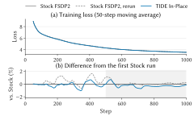

<!-- SPDX-FileCopyrightText: Copyright (c) 2026 Kuaishou Technology. All rights reserved. -->
<!-- SPDX-License-Identifier: Apache-2.0 -->
# Numerics and how they are validated

What TIDE's collectives compute, how that compares with stock FSDP2 on NCCL, and the tests that check it.
Every test named here is a leg of `scripts/gate.sh`, on one node and on N nodes (`test_abort.py` on one node only),
and must exit 0.

## What each collective computes

| Collective | Result | Against stock |
|---|---|---|
| All-gather | a byte copy: every (parameter, rank) piece lands at its final offset | bitwise identical |
| Reduce-scatter | bf16 or fp32 input, fp32 sum and output: `out = (accumulate ? out : 0) + scale * sum` | equal up to the fp32 summation order; bitwise for integer-valued inputs |

The reduce-scatter in more detail (`docs/design_rs.md` has the design):

- **Fixed summation order.** Inside a node, a few CTAs add the staged pieces in source order, then the rank's
  own piece, in fp32; bf16 inputs accumulate straight into fp32 (`add.rn.f32.bf16` on sm_100+, bitwise equal
  to convert-then-add). Across nodes, the fp32 partials are added by the NVSwitch (`multimem.ld_reduce`) as
  they land, 0.3 ulp from an fp64 sum in our measurements. Every run in every test was bitwise reproducible;
  the switch's own order is deterministic in our measurements, though not specified by NVIDIA.
- **Scale and accumulation in the landing.** AVG is `scale = 1/nranks`; the FSDP2 adapter folds FSDP2's
  divide factors into `scale`, and a gradient-accumulation microbatch adds into the existing fp32 shard.
- **Non-finite values** propagate as IEEE sums: NaN anywhere gives NaN, +Inf gives +Inf, +Inf meeting -Inf
  gives NaN.
- **Tuning does not change the result.** Sum and landing CTAs, the NIC round width, the staging chunk and the
  number of passes only schedule the same additions. The landing wave size is the one knob that regroups the
  cross-node sum; changing it, or the node count, can change the low bits, as with any reduction. With one rank
  per node (e.g. an expert subgroup) the round width regroups the sum too: each NIC round adds its blocks into
  the output, so k, which `test_rs_invariance.py` does not vary there, can change the low bits.

## Tests

| Test | Checks |
|---|---|
| `test_ag_bitwise.py` | all-gather against stock all-gather plus the parameter-major permutation, bitwise; a 100-iteration soak; NIC pacing variants |
| `test_rs_bitwise.py` | integer-valued inputs (every fp32 sum exact) bitwise equal to stock `torch._chunk_cat` + `reduce_scatter_tensor`; random inputs against an fp64 reduce-scatter; repeated calls bitwise identical; on one node, or one rank per node, also bitwise equal to an fp32 host sum in the kernels' order. Covers bf16 and fp32 inputs, scale and accumulate, segment sizes that are not multiples of the world size, misaligned rows, several plans per communicator and several landing waves |
| `test_rs_invariance.py` | communicators tuned differently give bitwise identical outputs on real-valued inputs, plain and with scale / accumulate |
| `test_rs_nonfinite.py` | NaN and Inf propagation through the node-local sum and the switch sum |
| `test_rs_tuning.py` | a plan sized by the solver reduces integer-valued gradients bitwise like stock |
| `test_fsdp_adapter.py` | training a toy FSDP2 model: with the TIDE all-gather, losses and final parameters bitwise equal to stock FSDP2; with the TIDE reduce-scatter as well (`--rs`), within 1e-4 of stock (the fp32 summation order differs) and bitwise equal between two TIDE runs (pipelined calls against one-phase ones on several nodes). Also gradient accumulation, uninstall and re-install, expert-parallel layouts and HSDP |
| `test_fence.py`, `test_concurrent_rs.py`, `test_abort.py` | ordering: no slot read before it is complete or overwritten while read, all-gather and reduce-scatter running concurrently, a communicator left closable after an abort |

A check that cannot fail proves nothing, so the fault-injection build (`scripts/build.sh`) adds negative legs:
each one skips a fence, a credit, a write or a zeroing step, and passes only if the check catches the fault.

## Results

- The gate has passed at 1, 8, 17 and 64 nodes of 8 GPUs (up to 512 ranks) on successive versions.
- Training against stock FSDP2: Qwen3-30B-A3B (128 routed experts, 8 active per token) from random initialization
  on C4 (`allenai/c4`, en), 8 nodes of 8 GPUs, 4 sequences of 4096 tokens per GPU, 1000 steps, TIDE in efficiency
  mode, stock NCCL 2.31.2. Deterministic kernels stay off (they would change the timing), so two stock runs with the
  same configuration diverge, and their difference is the scale for TIDE's. Over steps 500–1000 the largest relative
  difference of the 50-step moving-average loss is 0.73% between TIDE and the first stock run, 1.12% between the two
  stock runs and 1.07% between TIDE and the second stock run; at step 1000 (moving-average loss 3.53) TIDE is 0.15%
  below the first stock run and the second stock run 0.21% above it. No run had a non-finite loss or a skipped step.
  The per-step losses are in `figures/data.json`.

