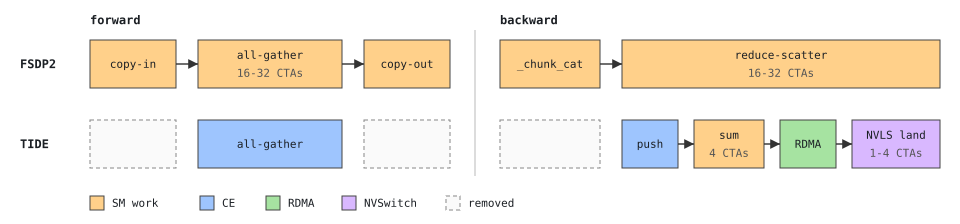
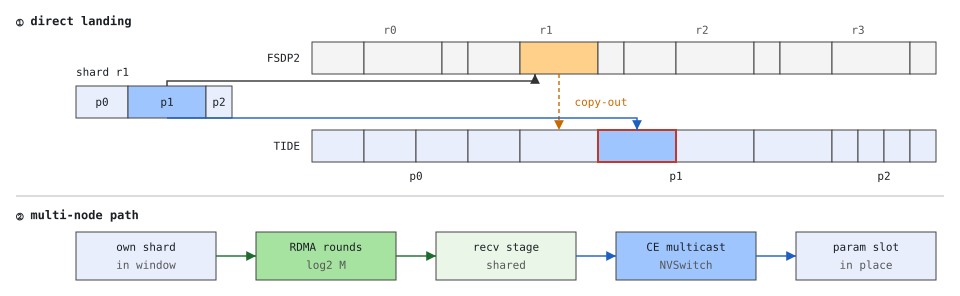
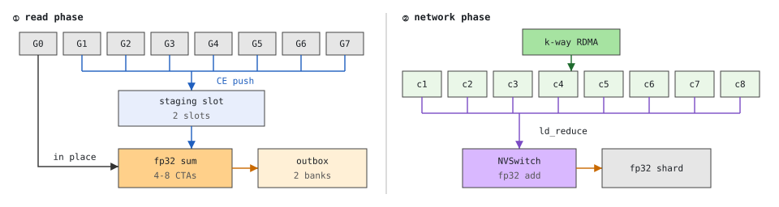

<!-- SPDX-FileCopyrightText: Copyright (c) 2026 Kuaishou Technology. All rights reserved. -->
<!-- SPDX-License-Identifier: Apache-2.0 -->
# TIDE overview

What a fully sharded step pays around its collectives, what TIDE changes, and how it relates to the
other ways of cutting that cost. Measurements: [benchmarks.md](benchmarks.md); internals:
[design_ag.md](design_ag.md), [design_rs.md](design_rs.md).

## 1. The glue around FSDP's collectives

Per parameter group and step, FSDP2 runs:

| step | work | runs on |
|---|---|---|
| copy-in | copy the sharded parameters into one contiguous send buffer | a copy kernel |
| all-gather | rank-major output: rank r's whole shard, then rank r+1's | NCCL kernel, 16-32 CTAs |
| copy-out | scatter the rank-major output into each parameter's unsharded storage (`split_with_sizes_copy`) | a copy kernel |
| gradient packing | pack the unsharded gradients into one fp32 buffer in reduce-scatter order (`_chunk_cat`) | a whole-GPU kernel |
| reduce-scatter | sum over ranks, keep this rank's slice | NCCL kernel, 16-32 CTAs |

Only two rows move data between GPUs. The other three exist because the collective's layout (rank
major, contiguous) differs from the model's (parameter major, one tensor per parameter). They cost
HBM passes and launches, and the resident communication CTAs slow the compute kernels running next to
them, most of all a small-M GEMM that has one CTA per SM (+69% next to NCCL's reduce-scatter, +71% with FSDP2's
packing; [benchmarks](benchmarks.md#overlap-with-compute)).

## 2. What TIDE changes

**All-gather: layout-aware landing.** The plan is a byte table (size and offset of each parameter's
shard). Piece `(p, r)` lands at `offsets[p] * N + r * sizes[p]`, which is exactly where the unsharded
parameter p keeps rank r's rows, so the landing buffer is the parameters' storage and the copy-out
disappears. The sharded parameters themselves live in the same symmetric window and are read in
place, so the copy-in disappears too (a group that casts fp32 shards to a bf16 all-gather keeps its
cast kernel). The data path:

- one node: one copy-engine write per piece to the NVSwitch multicast address reaches all eight GPUs;
- across nodes: each shard crosses one NIC, to the same-index GPU of the other nodes (rail-aligned),
  in ceil(log2 M) rounds of recursive doubling; a round is paced (the next one leaves once the current
  one has landed on the receiver) so no port receives two flows, which on RoCE avoids congestion
  control; the landed shard is scattered from a receive stage into the node's windows by one multicast
  copy-engine pass (an extra HBM hop, no SM).

No SM runs: waits are CUDA stream memory operations and NCCL signal waits.

**Reduce-scatter: in-place input, fp32 sums, switch reduction.** Level 1, inside a node: copy
engines push each GPU's bf16 pieces into the owner's staging slot and 4 CTAs (8 on a single node) sum the eight pieces in
fp32 (the owner's own piece is read in place). Level 2, across nodes: fp32 partial sums cross the rail
in k-way rounds; node n's partial for a destination is computed on the local GPU whose position makes
it land, at the same offset, in a different local GPU's inbox, so the owner reads the sum of up to
eight nodes with one `multimem.ld_reduce` (the NVSwitch adds in fp32) and accumulates wave after wave.
The result is FSDP2's packed fp32 shard, with scale and gradient accumulation applied in the landing;
the summation order is fixed, and runs were bitwise reproducible in all our tests (the NVSwitch's
reduction order is deterministic in our measurements, though not specified by NVIDIA). Multi-node calls run in a read phase (the
pushes and level-1 sums, which wait only for the gradients) and a network phase queued behind the previous
call's, so one call reads while the previous one is on the NIC; the network phase can run in device
kernels on NCCL's GIN (`TIDE_RS_NET=device`, experimental) instead of host-issued rounds.

**What it costs.** Two landing slots for the groups that reshard after forward (the two unsharded
groups FSDP holds anyway: the one computing and the one prefetched), a receive stage of about U/L per
slot on multiple nodes (U the group's unsharded bytes, L the GPUs per node), a reduce-scatter area
of staging slots, inbox and outbox blocks (2.26-2.51 GiB from 2 to 8 nodes for 128 MiB per rank, against
FSDP2's fp32 packing buffer of the whole gradient, 8.12 GiB at 8 nodes), and TIDE's own NCCL
communicator (0.2 GiB per GPU with NCCL's default lazy connect). No fp32 gradient packing buffer. In the
FSDP2 adapter's efficiency mode (the default) the gradients are read in place, so one layer of them stays
alive until the next post-backward; throughput mode copies them into the slot their group has just left and
frees them ([usage.md](usage.md#fsdp2)).

## 3. Related approaches

**FSDP2 with symmetric memory** (`set_symm_mem_for_comm`, process group with
`NCCL_CTA_POLICY_ZERO`). FSDP2 allocates its staging buffers in NCCL symmetric windows, and NCCL runs
the all-gather on copy engines with no CTAs. That removes the all-gather's SM use but not its layout
work: the copy-in into the symmetric send buffer and the copy-out after it remain, as do the
reduce-scatter's gradient packing and CTAs. Measured side by side (1-8 nodes, 400G rails, minimum latencies): on
1-2 nodes NCCL's copy-engine all-gather is 3-10% faster than TIDE's; from 4 nodes it is 22-34% slower, because it
issues all M-1 puts at once into the receivers' ports, which TIDE's paced rounds avoid. On the wire the two are on
par; the difference FSDP2 feels is the copy-out, after which TIDE is 1.06-1.42x faster at the median than the faster
of FSDP2's paths (30 tensors, 32-128 MiB per rank).

**NCCL's symmetric kernels** (reduce-scatter over rail all-to-all with multimem, on symmetric
windows). On an already packed fp32 input a bare NCCL reduce-scatter is faster than TIDE's on 2-8 nodes (by 16% at
8 nodes and 128 MiB per rank, minimum latencies). That input is the catch: FSDP2 still has to pack the gradients into
it. With the packing counted (FSDP2 with symmetric memory, 128 MiB per rank), TIDE is faster at 8 nodes (25.0 vs
26.4 ms at the minimum, 25.6 vs 27.2 at the median) and slower at 2 and 4 nodes (7.6 vs 4.6, 13.9 vs 11.6); the full
table is in [benchmarks.md](benchmarks.md#reduce-scatter-against-what-fsdp2-pays-18-nodes). The kernels also hold
CTAs for the whole collective.

| | FSDP2 + symmetric memory | NCCL symmetric kernels | TIDE |
|---|---|---|---|
| copy-in / copy-out | kept | kept | none |
| gradient packing | kept | kept (into the window) | none (throughput mode: one bf16 copy into a slot) |
| SMs, all-gather | 0 | CTAs | 0 |
| SMs, reduce-scatter | CTAs | CTAs | 4-16 sum + 1-4 landing CTAs, NVSwitch adds |
| other collectives | all of NCCL | all of NCCL | all-gather, reduce-scatter only |

## 4. What TIDE does not do

- Convert dtypes on the wire: a group with fp32 shards and a bf16 all-gather keeps a cast kernel
  before the all-gather.
- Capture into CUDA graphs: graph replay measured slower than the eager batched-copy submission.
- Collectives other than the all-gather and reduce-scatter of dim-0 sharding: tensor and context
  parallelism and the expert all-to-all keep their own (the FSDP2 groups of expert weights do run on
  TIDE, with `install(subgroups=True)`).
- Run without NVLS multimem across nodes, or with more than eight GPUs per NVLink domain.
